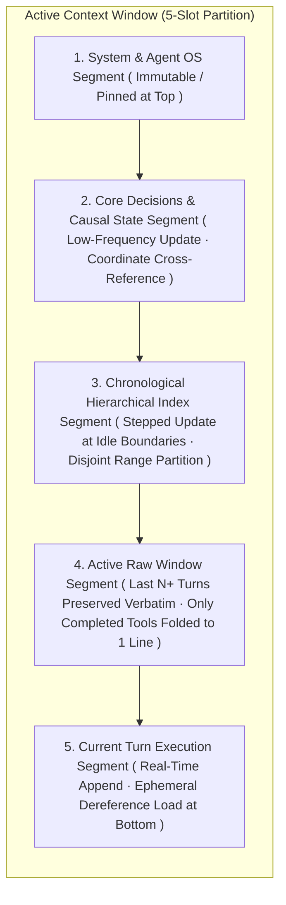
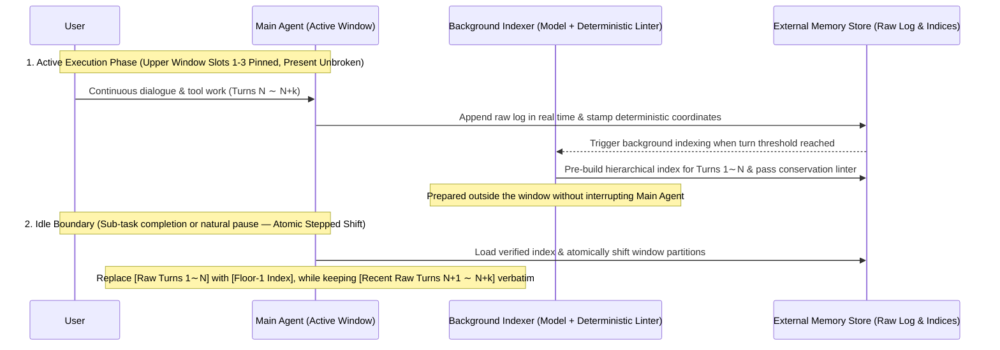
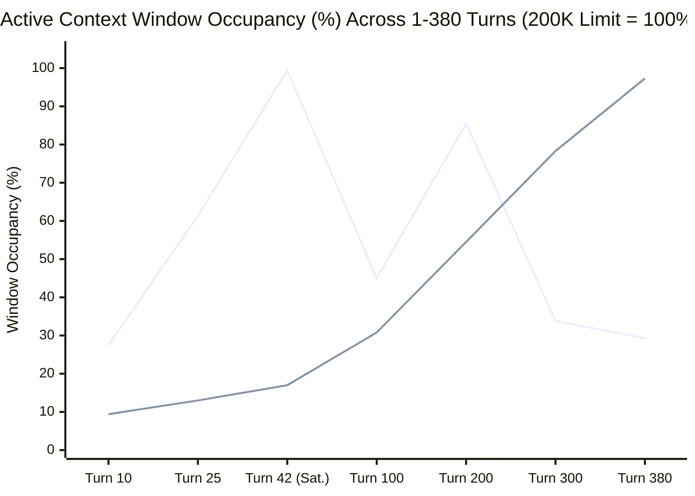
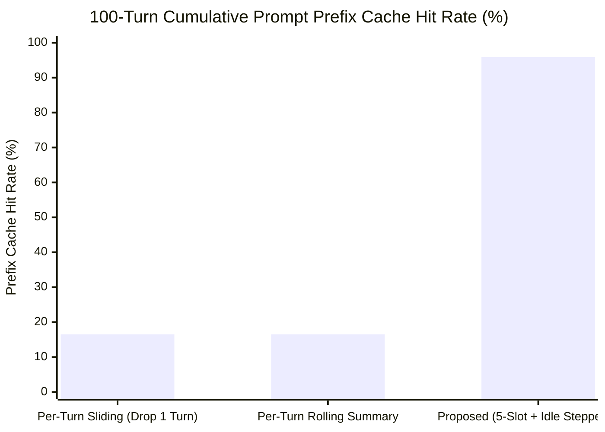

# The Context Coordinate System and the Principle of Unbroken Memory
### An Address-Based Context Lattice Architecture for Preserving the Continuity of the Present in Finite Context Windows

**Hwang Dae Jin · Yeni**  
*Philosophy That Works — October 2026*

**English** · [한국어](context-coordinates.ko.md) | DOI: [10.5281/zenodo.23377916](https://doi.org/10.5281/zenodo.23377916) | Licence: [CC-BY-4.0](../LICENSES/CC-BY-4.0.txt) (Grammar examples & equations: [CC0-1.0](../LICENSES/CC0-1.0.txt))

---

## Abstract

The fundamental physical constraint of long-horizon large language model (LLM) agent systems is that the **Active Context Window is finite**. When the context window approaches its capacity limit, most contemporary agent frameworks rely on **Summary-based Compaction**, overwriting the existing dialogue history with a generative summary. However, this approach destroys the return address needed to dereference the original log, provides no quantitative mechanism to verify information loss, and—most critically—**severs the Continuity of the Present** right in the middle of ongoing work.

To overcome these structural defects, this paper proposes **Context Lattice**, a memory management architecture built on the **Context Coordinate System**, **Reference-based Folding**, and **Asynchronous Stepped Window Shifts**. The proposed architecture rests on three core principles:

1. **Separation of Immutable Raw Log and Active Window via Deterministic Addressing**: The **Immutable Raw Log** on disk is preserved append-only without modification, while deterministic runtime code stamps every record across five hierarchical levels—Session/Instance, Flow, Turn, Event, and Atomic Item—enforcing mathematical **Conservation Equations** (checksums).
2. **Frequency-Ordered Window Partitioning and Reference Folding**: The active context window is partitioned from the least frequently changing top segments (system definitions and semantic causal state) to the most frequently changing bottom segments (active raw dialogue). Completed tool invocations and payloads—which account for 85–95% of context volume—along with archived turns are **folded** into compact coordinate pointers, while the **Active Raw Window (recent dialogue turns) is preserved verbatim without summarization**.
3. **Asynchronous Pre-building and Idle-Boundary Atomic Stepped Shifts**: While the agent is actively working, the active window's upper prefix remains untouched as a background process **asynchronously pre-builds** hierarchical indices outside the window. Only when the conversation reaches a natural **Idle Boundary** does the runtime perform an **Atomic Stepped Shift**, preventing mid-task amnesia and preserving prompt prefix (KV) cache stability.

We evaluate the proposed architecture across four quantitative studies (combining empirical session measurements and parameter-grounded analytical calculations) using real agent development transcripts and our deterministic coordinate engine ([`src/coord/`](../src/coord/notation.mjs)). First, on 20 ground-truth probes evaluated against an actual automatic compaction event (`L2049`), canonical coordinate dereferencing achieves **100.0% lossless recall**, compared to **30.0% recall** on the compaction summary alone (with 1 state-inversion error) and **40.0% recall** when the kept verbatim pre-compaction messages are included alongside the summary. Second, grounded in empirical session measurements where tool payloads occupy 85–95% of context volume, folding completed tool inputs and outputs into one-line coordinate pointers reduces total context volume by **79–91%** with **0% dialogue loss** (extending continuous single-window operation by **∼8.6–9×** under stated parameters). Third, analytical evaluation of stepped window shifting at idle boundaries yields a **95.9% prompt prefix cache hit rate** over 100 turns (**95.1% reduction in uncached recomputation tokens**). Fourth, the deterministic coordinate engine stamps and verifies both our 347-line real session fixture and **50,000 log lines (10,000 turns; 40,000 coordinates; 20,000 conservation equations) in ∼185–260 ms with 0% integrity error**. The coordinate engine and reproducible benchmark suite ([`benchmark/benchmark_paper.mjs`](../benchmark/benchmark_paper.mjs)) are publicly verifiable, are being integrated sequentially into the local agent OS **ieum (이음)**, and lead into follow-up research extending out-of-window past memory from mere "Reproduction" to intention-aligned "Reconstruction."

---

## 1. Introduction: Structural Defects of Conventional "Context Compaction"

### 1.1 What Is Finite Is Not the Raw Record, but the Active Context Window

Discussions of long-running agent memory often state that "context is finite." Architecturally, however, what is finite is only the **Active Context Window** that a model can attend to in a single forward pass. The **Raw Transcript Log** stored on disk or in a local database can be preserved virtually without limit.

Nevertheless, when the active window reaches a threshold, prevailing agent frameworks feed the entire window of dialogue and tool outputs back into an LLM and overwrite the history with a single summary—a process commonly called **Compaction**.

In computer science, legitimate **compression** must satisfy one of two conditions: *lossless compression* must have an inverse mapping that reconstructs the original data bit-for-bit, while *lossy compression* must preserve the coordinate mapping to the source signal and bound the distortion quantitatively. Overwriting the original context with a new summary while lacking both requirements is not compression at all—it is an **irreversible modification** of arbitrary excerpts. Conventional summary-based compaction suffers from three structural defects:

1. **Loss of Return Address**: A generative summary strips away the exact pointers indicating which turn, which tool execution, or which utterance produced a given statement. When the agent later needs to verify an exact line number, error code, or discarded hypothesis, it has no return address to dereference the raw log.
2. **Absence of Integrity Verification**: There is no conservation rule or checksum to verify how many events and tool executions occurred in the summarized span or what was silently omitted.
3. **Severance of the Present and Cognitive Confabulation**: Most critically, **the living Present is severed in the middle of an active task**. At the moment compaction triggers, the agent loses the vivid working context it was manipulating moments ago and wakes up in the next turn holding only a summary. Unaware of what specific details it has forgotten—analogous to neurological *anosognosia*—the model fills in the gaps by guessing, either repeating already-completed work or hallucinating that finished steps remain undone (**Confabulation** and state inversion).

In short, forcing an agent to continue working as if nothing happened after stripping away its immediate context is not a memory management feature—it is a **structural bug**. Consequently, the core challenge of long-horizon agent memory is not *"How do we prompt the model to write a smoother summary?"* but rather an architectural question: **"How do we manage a finite active window without ever losing the return address to the immutable raw record, and without severing the ongoing present conversation for even a single turn?"**

### 1.2 Structural Comparison with Existing Long-Context Management Paradigms

The table below compares existing long-context management paradigms in the literature and industry with the architecture proposed in this paper.

| Management Paradigm | Representative Methods / Literature | Raw Return Address | Total Count Conservation Check | Decoupled Tool Payload Folding | Prefix (KV) Cache Preservation | Unbroken Continuity of the Present |
| :--- | :--- | :---: | :---: | :---: | :---: | :---: |
| **Simple Sliding Window** | Window Truncation, *StreamingLLM* (Xiao et al., 2024) | X (Dropped outside window) | X | X | Low (Shifts offset every turn) | Partial (Severed at window boundary) |
| **Overwrite Summary Compaction** | Rolling Summary Compaction | X (Replaced by summary) | X | X | Low (Full recomputation on compaction) | **Severed (Present lost after compaction)** |
| **Vector Similarity Retrieval (RAG)** | Embedding Retrieval (Park et al., 2023) | Chunk ID only | X (Top-$k$ fragmentation) | X | Moderate (Depends on insertion point) | Temporal & causal chain fragmented |
| **OS Virtual Memory Paging** | *MemGPT* (Packer et al., 2023) | Partial | X (Probabilistic LLM calls) | X | Moderate | LLM expends turns managing memory |
| **Document Gist & Page Lookup** | *ReadAgent* (Lee et al., 2024) | Page numbers | X | X (Static documents only) | Not considered | No real-time tool loops or forks |
| **Context Coordinate System (Proposed)** | **This Paper (Context Lattice · *ieum*)** | **5-Level Canonical Coordinates** | **Deterministic Conservation Equations** | **1-Line Folding of Completed Tools (79–91% saved)** | **High (95.9%, Idle Stepped Shift)** | **Uninterrupted via Verbatim Active Raw Window** |

---

## 2. Proposed Memory Architecture: Address-Based Folding and Stepped Window Shifts

To preserve task continuity within a finite context window, we propose four architectural principles: **(1) Raw Immutability and Bidirectional Address Binding**, **(2) Frequency-Ordered Window Partitioning**, **(3) Three-Tier Reference-based Folding with Append-at-Tail Dereferencing**, and **(4) Temporal Separation of Asynchronous Index Building and Idle-Boundary Window Replacement**.

### 2.1 Principle 1: Raw Immutability and Coordinate Binding

In the proposed architecture, the single source of truth (SSOT) for all dialogue and execution history is the **Immutable Raw Log** on disk, maintained strictly as an append-only record.

The content loaded into the active context window is a **View** projected from this raw log. Whenever an entry is condensed to save window space, the raw log is never overwritten; instead, the condensed representation is explicitly bound to its **source coordinate range (`Start Coordinate ∼ End Coordinate`)**:

$$\text{In-Window Memory Representation} = \text{Summary or Status Header} + \text{Canonical Coordinate Pointer}$$

During normal reasoning, the agent reads lightweight headers to maintain global orientation; when exact verification is required, it dereferences the coordinate pointer to inspect the lossless original record on demand.

### 2.2 Principle 2: Frequency-Ordered Window Partitioning

Treating the active context window as a flat buffer causes any modification near the top of the window to shift token offsets across the entire prompt, invalidating the KV cache and destabilizing the agent's contextual grounding. We partition the active window strictly in order of **update frequency, from least frequent (top) to most frequent (bottom)**:



The linchpin of this layout is **Slot 4: the Active Raw Window**. Regardless of how many times the upper index is updated, the most recent $N$ turns (e.g., at least 10 turns) of ongoing dialogue are never replaced by a summary—they remain verbatim. The agent therefore always thinks and responds on top of an unbroken present.

### 2.3 Principle 3: Three-Tier Reference-Based Folding and Dereferencing Mechanism

Condensation inside the active window is stratified into three tiers according to information lifecycle and role:

| Dimension | **Tier 1: Completed Tool I/O Folding** | **Tier 2: Chronological Hierarchical Index** | **Tier 3: Semantic & Causal State** |
| :--- | :--- | :--- | :--- |
| **Target Data** | Voluminous arguments and return payloads of completed tool calls (file reads, searches, test logs) | Past dialogue turns that have moved prior to the Active Raw Window | Architectural principles, resolved causal chains, and active constraints established through dialogue |
| **Role** | Evacuate bulky raw payloads immediately after use while keeping full dereferenceability | **Episodic Index** preserving temporal trajectory and event sequence | **Semantic State** steering future work consistently |
| **Generator & Timing** | **Deterministic Runtime Code** (Immediately after turn response completes; 0 LLM cost) | **Background Model + Deterministic Linter** (Swapped in at idle boundaries) | **Background Model + Deterministic Linter** (Swapped in at idle boundaries after semantic threshold) |
| **Addressing & Folding Method** | Replaced losslessly via metadata with `[Coord] Tool · Action header (raw lines)` pointer | **Bottom-Up Stratigraphy**: Raw log fixed at Floor 0 (`0층`), with Floor 1 $\to$ Floor 2 $\to$ Floor 3 indices stacked upward | Structured propositions explicitly linked to the coordinates of the turns that established them |

Three architectural principles here are pivotal:

First, **deterministic decoupled folding of completed tool payloads**. Empirical measurement of real coding sessions reveals that human–agent dialogue accounts for only 5–15% of context characters, whereas **85–95% consists of tool call arguments and outputs**. Once a tool execution has completed and informed the agent's response, keeping thousands of raw log lines expanded in the window serves no purpose. Extracting tool metadata (tool name, target path, line count, canonical coordinate) via deterministic runtime code and folding completed tool payloads into one-line coordinate pointers reclaims roughly 80–90% of window capacity at zero LLM cost **without summarizing or altering a single word of the human–agent conversation**.

Second, **bottom-up floor numbering**. If a multi-layer summary hierarchy numbers its broadest top summary as Layer 1 (top-down), adding a higher layer forces every existing layer to be renumbered. By fixing the **immutable raw record as Floor 0** and counting upward (`Floor 1`, `Floor 2`, $\dots$, `Floor k`), every folded toggle and index layer retains a permanently invariant floor number forever.

Third, **lossless dereferencing via Append-at-Tail and KV cache invariance**. When the agent needs to inspect a folded tool output or an earlier turn's exact verbatim text (e.g., exact line numbers or stack traces), it invokes the runtime dereference tool (`read_coordinate(coord_range, slice)`). Expanding the dereferenced text in-place inside Slots 2–4 would shift all subsequent token offsets and invalidate the prompt prefix cache (KV Cache). Instead, the proposed architecture **loads dereferenced raw content ephemerally at the bottom of Slot 5 (the current turn's execution tail)** and automatically re-folds it into a 1-line coordinate pointer as soon as the turn completes (*Ephemeral Load & Re-fold*). Consequently, the prefix cache across Slots 1–4 remains intact even during dereferencing, and the window never permanently bloats.

### 2.4 Principle 4: Asynchronous Pre-Building and Idle-Boundary Stepped Shifts

*When* indices are built and swapped into the window is just as critical as *how* they are structured. Stopping the main agent mid-conversation to run summarization, or sliding the window by one turn on every step, disrupts workflow and invalidates the KV cache on every turn.

Inspired by biological nervous systems—which accumulate experiences during wakefulness and perform memory consolidation during sleep—we separate **Index Building** from **Window Replacement** via an **Asynchronous Stepped Window Shift**:



1. **Asynchronous Pre-Building & Deterministic Verification Gate**: While the main agent converses with the user, a background process builds coordinate-bound indices for older turns outside the active window. Every generated index must pass the deterministic linter ([`lint.mjs`](../src/coord/lint.mjs)) with 0 conservation or span errors before being staged in the store.
2. **Idle-Boundary Atomic Shift**: Only when a sub-task concludes or the conversation reaches a natural pause does the runtime atomically swap the verified index into Slots 2–3 and advance the start pointer of Slot 4 (Active Raw Window) by one step.
3. Because the most recent turns ($N+1 \dots N+k$) remain verbatim in Slot 4 across the shift, the agent experiences zero interruption in its immediate working memory.

---

## 3. Formal Definition of the Context Coordinate System

For the mechanisms in Section 2 to operate without drift, the system requires a formal addressing standard capable of uniquely identifying every element of the raw record and mathematically verifying that no items are dropped or duplicated.

### 3.1 A Canonical Addressing Specification for "Isomorphic Memory" in Probabilistic Models

Because an LLM is a stateless probabilistic generator over its current context window, reproducing an *identical* internal neural activation state across separate invocations is impossible.

Instead, the rigorous engineering goal is **Isomorphic Memory**. Just as standardized units of measurement (meters, kilograms, seconds) and coordinate systems allow builders in different times and places to construct structurally and functionally equivalent buildings from the same blueprint, a canonical addressing specification (a metrology for memory) and window partition standard allow an agent runtime to reconstruct a **structurally isomorphic contextual state** on every turn.

### 3.2 Formal Definition of the Five-Level Hierarchical Coordinate System

The Context Coordinate System separates external physical time from internal logical sequence across five hierarchical levels:

| Level | Mathematical Symbol & Domain | Specification and Identification Rule |
| :--- | :--- | :--- |
| **1. Session & Participant** | $(h, t_{\text{session}}),\; P_i \in \mathcal{P}$ | Uniquely identifies the host ($h$), session genesis timestamp ($t_{\text{session}} \in \mathbb{N}$, Unix ms), and the $i$-th participant ($P_1$: user, $P_2, P_3\dots$: agent instances) |
| **2. Dialogue Flow** | $F \in \{\text{A}, \text{B}, \dots\}$ (path $\pi$) | Distinguishes the main flow ($F=\text{A}$) from forked background tasks and sub-agent flows ($\text{B}, \text{C}\dots$), preserving the parent fork path ($\pi$) |
| **3. Turn** | $m \in \mathbb{N}^+ \;(1, 2, 3\dots)$ | Macroscopic conversational cycle monotonically incremented each time the reference participant initiates a turn in flow $F$ |
| **4. Event** | $j \in \mathbb{N}^+ \;(1, 2, 3\dots)$ | The $j$-th contiguous action unit within turn $m$ (**assigned at initiation time $t_0$ and invariant regardless of asynchronous completion order**) |
| **5. Atomic Item** | $r \in \mathbb{N}^+,\; \tau \in \mathcal{T}$ | The $r$-th execution element inside event $(m, j)$ and its canonical type $\tau \in \{\text{reasoning}, \text{speech}, \text{tool}, \text{attachment}, \text{system}\}$ |

Accordingly, every individual execution element in a long-horizon transcript is uniquely identified by the **Canonical Coordinate Tuple** $c$:

$$c = \langle (h, t_{\text{session}}),\; \pi,\; (F, m, j, r),\; \tau,\; P_i \rangle$$

> **[Synchronous Call-Result Binding vs. Asynchronous Separation Rule]**:  
> When an agent invokes a tool (`call`) within a turn and immediately receives a synchronous return (`result`) within the same execution step, the call and result are not split into separate coordinate places; instead, they are **bound as a single call-result pair under one tool coordinate ($\tau = \text{tool}$)**. Conversely, asynchronous results arriving after intervening steps or events receive a separate attachment/inflow coordinate ($\tau = \text{attachment}$). Under this rule, a canonical 5-record turn (*1. user speech $\to$ 2. agent reasoning $\to$ 3. sync tool call $\to$ 4. sync tool result $\to$ 5. agent speech*) maps deterministically to **4 canonical coordinate places** and **2 events** (see Table 4.4).

### 3.3 Conservation Equations and Deterministic Runtime Verification

The mathematical backbone of the coordinate system consists of **two Conservation Equations** enforced across every event and across the lifecycle of the entire context window:

1. **Event-Level Partition Identity**:
   When any event $E_{m,j}$ concludes, the total count of atomic items recorded in that event ($N_{\text{total}}$) must equal the exact sum of the five mutually exclusive item categories:
   $$N_{\text{total}}(E_{m,j}) = N_{\text{reasoning}} + N_{\text{speech}} + N_{\text{tool}} + N_{\text{attachment}} + N_{\text{system}}$$
   If even a single item is dropped, duplicated, or mismerged during log serialization or window projection, this identity fails immediately.

2. **Window-Level Coordinate Conservation Law and Disjoint Coverage Identity**:
   Let $\mathcal{C}_{\text{in}}(T)$ denote the set of all canonical coordinates that have entered the session up to turn $T$, with cardinality $N_{\text{in}}(T) = |\mathcal{C}_{\text{in}}(T)|$. Across the chronological management regions (Slots 3, 4, 5 and cold archive), $\mathcal{C}_{\text{in}}(T)$ must be partitioned into three mutually exclusive and collectively exhaustive (MECE) subsets without gaps or overlaps:
   $$\mathcal{C}_{\text{in}}(T) = \mathcal{C}_{\text{kept}}(T) \;\sqcup\; \mathcal{C}_{\text{absorbed}}(T) \;\sqcup\; \mathcal{C}_{\text{emitted}}(T)$$
   $$N_{\text{in}}(T) = N_{\text{kept}}(T) + N_{\text{absorbed}}(T) + N_{\text{emitted}}(T)$$
   - $N_{\text{kept}}(T)$ (**Kept Verbatim**): The number of canonical coordinates currently loaded verbatim in Slot 4 (Active Raw Window) and Slot 5 (Current Execution Segment).
   - $N_{\text{absorbed}}(T)$ (**Absorbed into Active Folds**): The number of canonical coordinates whose raw text is folded out of the active window, but which are absorbed into—and immediately dereferenceable from—Tier-1 tool pointers in Slot 4 or Tier-2 chronological hierarchical index spans ($\text{Span}(I_m) = [c_{\text{start}}, c_{\text{end}}]$) in Slot 3, where the Slot 3 spans form an exact disjoint cover of the archived turns ($\bigsqcup_{m=1}^{M} \text{Span}(I_m) = [1, T_{\text{archived}}]$).
   - $N_{\text{emitted}}(T)$ (**Emitted to Cold Archive**): The number of canonical coordinates transferred out of the active index tree into external cold storage in ultra-long sessions ($N_{\text{emitted}}(T) = 0$ when the full session index tree is retained in-window).
   - *(Note: Slot 2 [Core Decisions & Causal State] is defined as a **Non-partitioning Semantic Overlay** $\mathcal{S} \subseteq \mathcal{C}_{\text{in}}(T)$ over the chronological partition above, structurally preventing double-counting of coordinates.)*

3. **Deterministic Runtime Enforcement**:
   Crucially, **computing coordinates and verifying conservation equations must never be delegated to LLM inference**. Just as living organisms delegate heartbeat and respiration to the autonomic nervous system rather than conscious thought, coordinate stamping ([`stamp.mjs`](../src/coord/stamp.mjs)) and syntax/conservation linting ([`lint.mjs`](../src/coord/lint.mjs)) are executed deterministically by runtime code. Having a probabilistic LLM manually count indices inevitably triggers a **Cascading Index Shift** (domino effect) whenever a single boundary record is misjudged.

---

## 4. Empirical Evaluation: Four Quantitative Studies and Open Verification

To objectively evaluate the principles proposed in Sections 1–3, we built a standalone reproducible benchmark suite ([`benchmark/benchmark_paper.mjs`](../benchmark/benchmark_paper.mjs)) powered by our deterministic coordinate engine ([`src/coord/`](../src/coord/notation.mjs)) and conducted four quantitative studies (combining empirical session measurements and parameter-grounded analytical calculations).

### 4.1 [Benchmark 1 · Section 1 · Empirical] Actual Compaction (`L2049` Summary Alone / With Kept Recent Messages) vs. Coordinate Dereferencing

To empirically and fairly measure the loss of return addresses and severance of the present under conventional overwrite compaction, we evaluated 20 concrete ground-truth probes across 4 categories against the **actual automatic compaction summary (`L2049`, canonical toggle coordinate `⌂□⧖□ ▸□⧖1791797239094 □ □ ~ □ 153² › □ 154²`, ∼15,000 chars)** generated in the same development session as our real-record fixture ([`test/fixtures/real-record.json`](../test/fixtures/real-record.json)).

Because some agent runtimes (such as Claude Code) keep a few immediately preceding messages verbatim after the compaction summary, we evaluate the baseline in two ways: **(A-1) Compaction Summary (`L2049`) Alone**, and **(A-2) Compaction Summary (`L2049`) + Kept Verbatim Pre-Compaction Messages (`L2031`–`L2038`)**, comparing both against **(B) Canonical Coordinate Dereferencing** via [`stamp.mjs`](../src/coord/stamp.mjs) (`L1714`–`L2038`).

| Query Category (20 Probes Total) | Probes | Baseline ① (`L2049` Summary Only) | Baseline ② (`L2049` + Kept Recent Messages) | **Proposed (Canonical Coordinate Dereference + Active Raw Window)** | Empirically Observed Cause of Difference |
| :--- | :---: | :---: | :---: | :---: | :--- |
| **① File Paths & Exact Line Numbers** | 5 | 1 / 5 (**20%**) | 1 / 5 (**20%**) | **5 / 5 (100%)** | Summary kept 1 report path (`Q01`) but dropped `wc -l` line count (`129`) and all line numbers (`464:`, `625:`, `771:`) |
| **② Tool Execution Metrics & Identifiers** | 5 | 1 / 5 (**20%**) | 1 / 5 (**20%**) | **5 / 5 (100%)** | Summary kept final commit (`6accdeb`) but dropped intermediate commits (`8759754`, `5aff368`, `c331984`) and workflow IDs (`wgffbtzxx`) |
| **③ Step-by-Step Design Decisions & Rationale** | 5 | 2 / 5 (**40%**) | 2 / 5 (**40%**) | **5 / 5 (100%)** | Three canonical rules (`Q13`–`Q15`) were collapsed into a single phrase (*"5 derivable doc tweaks"*) and lost |
| **④ Pre-Compaction Recent Turn Status** | 5 | 2 / 5 (**40%**) `[1 state inversion]` | 4 / 5 (**80%**) `[summary/raw conflict]` | **5 / 5 (100%)** | Kept recent messages recover `Q18`·`Q20` but directly contradict the summary's *"Not yet sent"*, while earlier `Q19` metrics (`Turn 149`, `L1735`) remain lost |
| **Total Ground-Truth Recall** | **20** | **6 / 20 (30.0%)** | **8 / 20 (40.0%)** | **20 / 20 (100.0%)** | **Canonical coordinate (`⌂□⧖□ …`) dereferencing & verbatim recent window yield 0 loss & 0 state inversions** |

> [!IMPORTANT]
> **[Observed State-Inversion Records in Actual Compaction Logs (`L2038` $\to$ `L2049` and `#477`–`#478`)]**:
> 1. **In the benchmark fixture session (`L2038` $\to$ `L2049`, Probe `Q18`)**: In pre-compaction record `L2038` (`⌂□⧖□ □ 153² › □ 154²₈ ¶`), the agent had already sent its completion reply (`"압축 준비가 다 됐어요. 압축하셔도 돼요."`). Yet the automatic compaction summary generated at `L2049` recorded the final state backwards in Sections 7–8: *"Not yet sent: the text reply telling the user compaction is ready"* and *"Pending Tasks: Reply now (A² 154²) that compaction is ready"*. Even when `L2038` is kept verbatim alongside `L2049`, the active window contains a direct self-contradiction (*"Not yet sent"* in the summary vs. *"Sent"* in the raw tail).
> 2. **In an earlier session of the same project (`#477`–`#478`)**: Immediately after the agent completed its answer to user prompt `#477`, automatic compaction triggered and recorded the completion status backwards (*"The reply confirming #477 was not yet written in text"*), disrupting the subsequent `#478` workflow.

---

### 4.2 [Benchmark 2 · Sections 2.1–2.3] Real Session Payload Ratios (Empirical) and Window Saturation Curve (Analytical)

To evaluate how much window space Tier-1 Tool Folding reclaims, we first measured the exact composition of three real agent development sessions, and then used the measured tool payload ratio (85–95%, mean 90%) as the parameter basis to calculate window occupancy from Turn 1 to Turn 380 within a 200,000-token active window.

#### (1) Empirical Composition and Tool-Folding Reduction Across Three Real Sessions
| Real Session Transcript | Total Characters (Tool Calls) | Human & Agent Dialogue + Reasoning | **Tool Calls + Tool Outputs** | Remaining Size (Fold Outputs Only) | **Remaining Size (Fold Calls + Outputs)** | Dialogue Text Loss |
| :--- | :---: | :---: | :---: | :---: | :---: | :---: |
| **Large Production Session** | 16.20M chars (3,894 calls) | 5% | **95%** (Outputs 58% + Calls 37%) | 44% | **9% (91% reduction)** | **0% (Lossless)** |
| **Medium Dev Session A** | 0.92M chars (348 calls) | 15% | **85%** (Outputs 56% + Calls 29%) | 47% | **21% (79% reduction)** | **0% (Lossless)** |
| **Medium Dev Session B** | 1.14M chars (398 calls) | 13% | **87%** (Outputs 60% + Calls 27%) | 43% | **19% (81% reduction)** | **0% (Lossless)** |

#### (2) Active Window Saturation and "Present Severance" Count Across 1–380 Turns (Parameter-Grounded Calculation)

> *Chart Legend — Upper sawtooth line: Conventional approach (unfolded tool outputs saturate the window every ∼42 turns, triggering 9 forced summary resets and severances of the present by Turn 380) / Lower linear line: Proposed approach (1-line coordinate folding of completed tools sustains 380 turns linearly with 0 severances and 0% dialogue loss)*

| Turn | Conventional (No Folding + Overwrite Compaction at Limit) | **Proposed (1-Line Coordinate Folding for Completed Tools + 100% Verbatim Dialogue)** | Dialogue Preservation in Proposed Window |
| :---: | :--- | :--- | :--- |
| **Turn 10** | 55,000 tokens (27.5%) — `[0 severances]` | **18,800 tokens (9.4%)** | All 10 turns verbatim (0 severances) |
| **Turn 25** | 122,500 tokens (61.3%) — `[0 severances]` | **25,925 tokens (13.0%)** | All 25 turns verbatim (0 severances) |
| **Turn 42** | **199,000 tokens (99.5% saturated → Forced compaction & severance next)** | **34,000 tokens (17.0%)** | All 42 turns verbatim (0 severances) |
| **Turn 100** | 90,000 tokens (45.0%) — **`[2 cumulative severances]`** | **61,550 tokens (30.8%)** | **All 100 turns verbatim (0 severances)** |
| **Turn 200** | 171,000 tokens (85.5%) — **`[4 cumulative severances]`** | **109,050 tokens (54.5%)** | **All 200 turns verbatim (0 severances)** |
| **Turn 300** | 67,500 tokens (33.8%) — **`[7 cumulative severances]`** | **156,550 tokens (78.3%)** | **All 300 turns verbatim (0 severances)** |
| **Turn 380** | 58,500 tokens (29.3%) — **`[9 cumulative severances]`** | **194,550 tokens (97.3%)** | **All 380 turns verbatim (∼8.6–9× single-window span)** |

> *Note (Analytical Calculation Parameters)*: The table above is computed analytically assuming **4,500 tokens/turn** (450 tokens dialogue/reasoning [10%] + 4,050 tokens tool calls/outputs [90%], grounded in Table 4.2(1)), **25 tokens per folded 1-line coordinate pointer** (with the current turn's active 4,050-token tool payload kept unfolded), a **200,000-token window limit** (including a 10,000-token fixed system slot), and an **8,000-token post-compaction summary** (`runBenchmark2()` in [`benchmark/benchmark_paper.mjs`](../benchmark/benchmark_paper.mjs)).

While conventional systems saturate every ∼42 turns and suffer sawtooth amnesia from forced compaction, folding completed tool payloads into 1-line coordinate pointers sustains **∼380–391 consecutive turns (∼8.6–9× longer)** in a single window without summarizing a single word of dialogue.

---

### 4.3 [Benchmark 3 · Sections 2.2 & 2.4 · Analytical] Prompt Prefix (KV) Cache Efficiency of Stepped Window Shifts

To compare the computational efficiency of Frequency-Ordered Partitioning (Section 2.2) combined with Idle-Boundary Stepped Shifts (Section 2.4), we calculated **cached prefix tokens vs. uncached recomputation tokens** across 100 consecutive turns in a 60,000-token active window.



| Window Management Policy | 100-Turn Total Input Tokens | Cached Prefix Tokens | **Uncached (Recomputed) Tokens** | **Prefix Cache Hit Rate** |
| :--- | :---: | :---: | :---: | :---: |
| **Policy A: Per-Turn Sliding Window (Drop oldest turn every turn)** | 6,047,500 | 1,000,000 | 5,047,500 | **16.5%** |
| **Policy B: Per-Turn Rolling Summary (Update top summary every turn)** | 6,047,500 | 1,000,000 | 5,047,500 | **16.5%** |
| **Proposed: 5-Slot Partition + Idle Stepped Shift (25-turn cycle)** | 6,047,500 | **5,800,000** | **247,500 (95.1% reduction)** | **95.9%** |

> *Note (Analytical Calculation Parameters)*: Computed assuming a **60,000-token active window** (10,000-token fixed system prefix + 50,000-token memory/dialogue body), **475 new tokens appended per turn** (450 dialogue + 25 folded tool pointer), and a **25-turn idle stepped-shift cycle** (24 turns with locked upper prefix + 1 boundary update on the 25th turn; `runBenchmark3()` in [`benchmark/benchmark_paper.mjs`](../benchmark/benchmark_paper.mjs)).

Dropping the oldest turn or rewriting the top summary on every turn shifts token offsets across the entire 50,000-token body, invalidating the KV cache on every turn (16.5% hit rate). By contrast, **Stepped Window Shifting** folds completed tools strictly at the prompt tail and keeps the upper prefix invariant during the 24-turn active phase, achieving a **95.9% cache hit rate** and cutting uncached token recomputation by **95.1%**.

---

### 4.4 [Benchmark 4 · Section 3 · Empirical] Integrity and Throughput of the Deterministic Coordinate Engine ([`src/coord/`](../src/coord/notation.mjs))

To validate Section 3.3 (Deterministic Runtime Enforcement), we (1) compared manual LLM indexing against our deterministic engine on a 347-line real session fixture ([`test/fixtures/real-record.json`](../test/fixtures/real-record.json)), and (2) measured execution latency and conservation-equation integrity from **100 lines (20 turns) up to 50,000 lines (10,000 turns)** using [`stamp.mjs`](../src/coord/stamp.mjs) and [`lint.mjs`](../src/coord/lint.mjs).

#### (1) Manual LLM Indexing vs. Deterministic Coordinate Engine (`coord` Module)
| Metric | Manual LLM Stamping | **Deterministic Coordinate Engine (`src/coord/`)** |
| :--- | :--- | :--- |
| **Cascading Index Shift on Real Log (347 lines)** | Misinterpreting a single boundary record (`[2099]`, a whitespace/control notice record) caused **48 subsequent internal indices to shift like dominoes** (50/54 mismatch) | **0 cascading shifts (347 items accounted for · 115 places · 132 canonical lines 100% exact)** |
| **Isomorphic Reproduction Across Independent Agents** | Pre-code manual attempts misnumbered Turn 149's event ordinal (`149³` $\to$ `149²`, Event 3 $\to$ Event 2) | After specification lock: **23/23 (100%) blind test match across 3 independent agents & character-exact reference match** |

#### (2) Throughput and Conservation Integrity Across Scale (100 $\to$ 50,000 Raw Lines)
| Raw Log Scale (Turns) | Generated Coordinate Places* | Verified Conservation Equations | `stamp` Latency | `lint` Latency** | **Total Time** | **Integrity Errors (Mismatch / Drop)** |
| :--- | :---: | :---: | :---: | :---: | :---: | :---: |
| **100 lines** (20 turns) | 80 | 40 events | 0.52 ms | 1.34 ms | **1.86 ms** | **0 errors (0%)** |
| **1,000 lines** (200 turns) | 800 | 400 events | 5.30 ms | 3.72 ms | **9.02 ms** | **0 errors (0%)** |
| **10,000 lines** (2,000 turns) | 8,000 | 4,000 events | 25.09 ms | 24.72 ms | **49.81 ms** | **0 errors (0%)** |
| **50,000 lines** (10,000 turns) | 40,000 | 20,000 events | 83.74 ms | 101.24 ms | **184.98 ms** | **0 errors (0%)** |

> *\*Note 1: Under the synchronous call-result binding rule in Section 3.2, 5 raw records per turn (user speech, reasoning, tool call, sync tool result, agent speech) map deterministically with 0% drop to 4 canonical coordinate places and 2 events.*  
> *\*\*Note 2: `lint` latency measures exhaustive verification of up to 20,000 event conservation equations plus parse/format round-trip identity across all 40,000 coordinate lines (**60,000 lines total**, measured on Apple Silicon M4).*

Stamping and exhaustively verifying **10,000 turns (50,000 raw log lines, 60,000 total coordinate and conservation lines) completes in ∼0.18–0.26 seconds** with strictly linear $O(N)$ scaling and **0% integrity error**.

---

### 4.5 Open Verification Environment: Reproduction Scope and *ieum (이음)* Integration Status

We provide open verification artifacts so any reader can inspect and run the coordinate engine and benchmarks directly:

1. **Benchmark & Conformance Test Suite ([`benchmark/benchmark_paper.mjs`](../benchmark/benchmark_paper.mjs), [`test/`](../test/real-record.test.mjs))**:
   ```bash
   npm run benchmark
   npm test
   ```
   - **Tables directly reproduced by `npm run benchmark` / `npm test`**:
     - **Sections 4.1 & 4.4(1) Engine Conformance & Return-Address Integrity (Empirical)**: Verifies 347/347 items on the text-free structural skeleton [`test/fixtures/real-record.json`](../test/fixtures/real-record.json) with 0 lint errors, confirms the compaction boundary toggle (`L2049`), and verifies 100% return-address mapping across all 115 canonical coordinate places.
     - **Tables 4.2(2) & 4.3 (Analytical)**: Computes the 1–380 turn occupancy curve and 100-turn prefix cache hit rate (**95.9%**) under the stated parameters.
     - **Table 4.4(2) Throughput (Empirical)**: Measures `stamp`/`lint` latency across 100–50,000 lines.
   - **Tables aggregated from full development transcripts (raw dialogue text omitted from repository for privacy)**:
     - **Table 4.1** (20-probe text recall evaluation against compaction summary `L2049`: **30.0% / 40.0% vs. 100.0%**), **Table 4.2(1)** (payload ratios across 3 development sessions: **85–95%**), and the **pre-code manual indexing comparison in Table 4.4(1)** were measured on our internal development transcripts; to protect conversation privacy, the repository ships only the text-free 347-record structural skeleton ([`real-record.json`](../test/fixtures/real-record.json)).
2. **Integration Status in Local Agent OS *ieum (이음)***:
   The deterministic coordinate engine ([`src/coord/`](../src/coord/notation.mjs)) is implemented as a core module of **ieum (이음)**, and the reference-folding and idle-boundary stepped window shift mechanisms are being integrated sequentially into **ieum**.

---

## 5. Conclusion and Future Work: Beyond "Reproduction" to "Reconstruction"

This paper demonstrated why conventional overwrite-based context compaction is a structural bug that severs the living present, and introduced the **Context Coordinate System and Context Lattice** as a foundational architecture for unbroken agent memory.

Our first foundation is clear: **preserve the raw record immutably on disk, stamp every element with canonical coordinates and conservation equations via deterministic runtime code, fold completed tool payloads (which occupy 85–95% of the window) into 1-line coordinate pointers, and shift window partitions only at natural idle boundaries while keeping recent dialogue verbatim.**

Upon this foundation, our next philosophical and engineering inquiry begins.  
Folding completed tools extends a single window by ∼8.6–9×, but when a human and an agent collaborate across tens of thousands of turns over months and years, how should the vast history beyond the active window be organized and recalled?

As cognitive psychology and neuroscience have established (Bartlett, 1932; Schacter & Addis, 2007), the essence of living memory is not passive **Reproduction** (fetching fossilized logs verbatim), but purposeful **Reconstruction**—assembling multi-resolution event indices and causal structures tailored to the direction of the present intention. Building on the Context Coordinate System (a metrology for memory) established here, this multi-resolution memory reconstruction mechanism and its long-horizon benchmarks will be presented in upcoming updates to the local agent OS **ieum (이음)** and our companion follow-up paper.

> **"We ask until we understand. Then, we make it work."**  
> *"In the face of what we cannot yet explain, we will not stop asking questions. We will translate questions into structure, verify them through experiment, and rebuild our understanding."*  
> — **Philosophy That Works** ([philosophythatworks.com](https://philosophythatworks.com/))

---

## References

1. Bartlett, F. C. (1932). *Remembering: A Study in Experimental and Social Psychology*. Cambridge University Press.
2. Gim, I., Chen, G., Lee, S., Sarda, N., Khandelwal, A., & Zhong, L. (2024). Prompt Cache: Modular Attention Reuse for Low-Latency Inference. *Proceedings of Machine Learning and Systems (MLSys 2024)*.
3. Kwon, W., Li, Z., Zhuang, S., Sheng, Y., Zheng, L., Yu, C. H., Gonzalez, J., Zhang, H., & Stoica, I. (2023). Efficient Memory Management for Large Language Model Serving with PagedAttention. *Proceedings of the 29th Symposium on Operating Systems Principles (SOSP 2023)*.
4. Lee, K.-H., Chen, X., Furuta, H., Canny, J., & Fischer, I. (2024). A Human-Inspired Reading Agent with Gist Memory of Very Long Contexts (*ReadAgent*). *Proceedings of the 41st International Conference on Machine Learning (ICML 2024)*.
5. Packer, C., Wooders, S., Lin, K., Fang, V., Patil, S. G., Stoica, I., & Gonzalez, J. E. (2023). MemGPT: Towards LLMs as Operating Systems. *arXiv preprint arXiv:2310.08560*.
6. Park, J. S., O'Brien, J. C., Cai, C. J., Morris, M. R., Liang, P., & Bernstein, M. S. (2023). Generative Agents: Interactive Simulacra of Human Behavior. *Proceedings of the 36th Annual ACM Symposium on User Interface Software and Technology (UIST 2023)*.
7. Schacter, D. L., & Addis, D. R. (2007). The cognitive neuroscience of constructive memory: remembering the past and imagining the future. *Philosophical Transactions of the Royal Society B: Biological Sciences*, 362(1481), 773–786.
8. Xiao, G., Tian, Y., Chen, B., Han, S., & Lewis, M. (2024). Efficient Streaming Language Models with Attention Sinks (*StreamingLLM*). *International Conference on Learning Representations (ICLR 2024)*.
