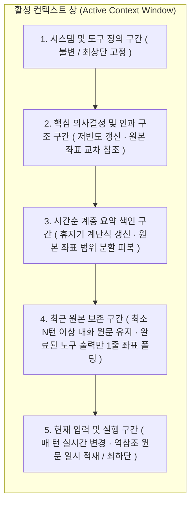
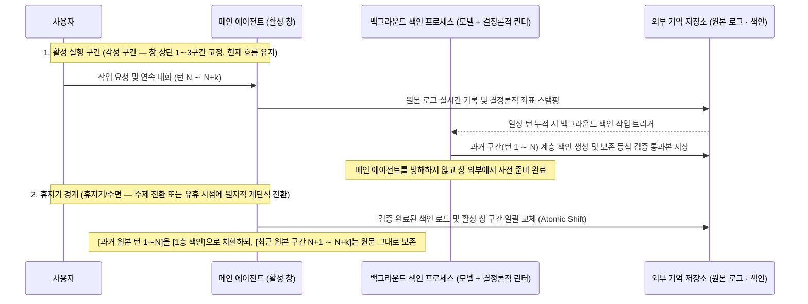
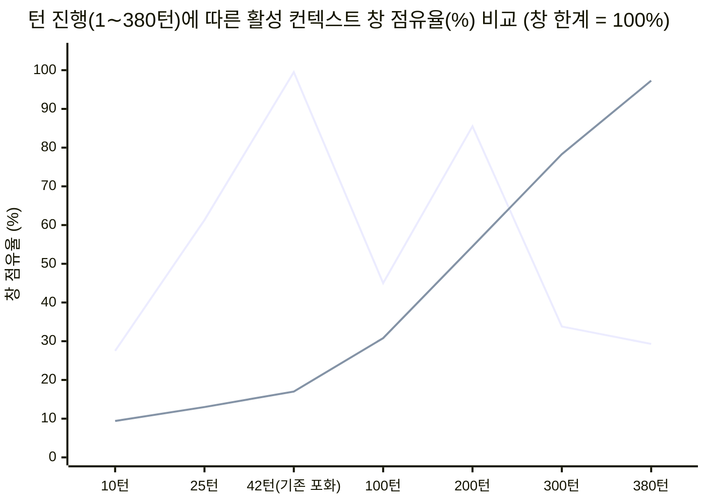
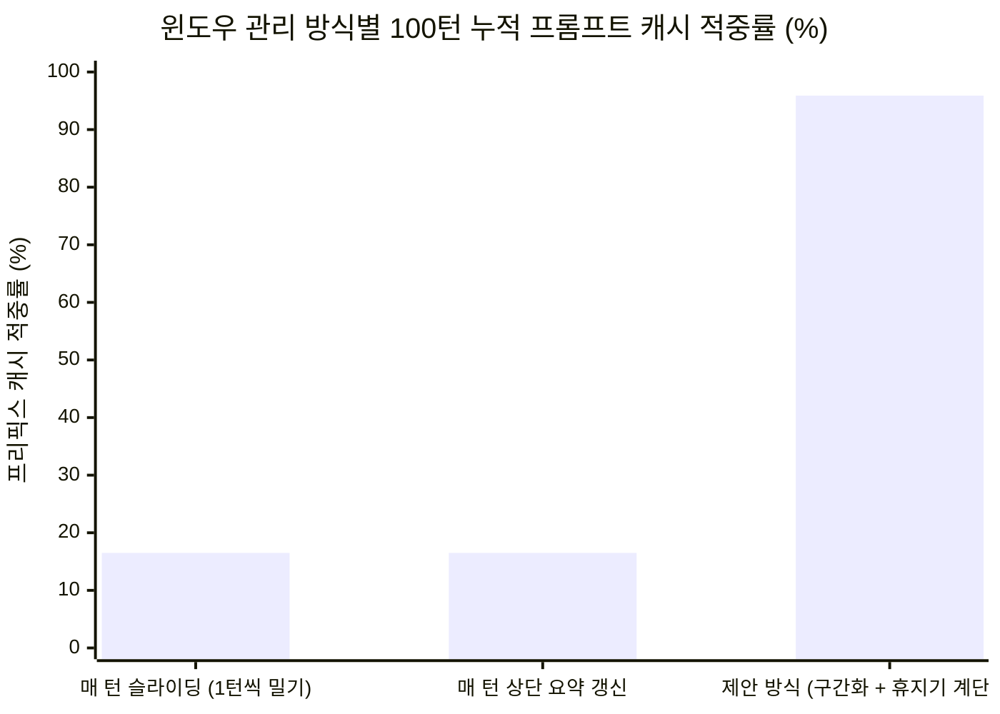

# 컨텍스트 좌표계와 끊기지 않는 기억의 원리
### 유한한 컨텍스트 창에서 작업의 연속성을 보존하는 주소 기반 컨텍스트 관리 구조의 제안

**황대진 (Hwang Dae Jin) · 예니 (Yeni)**  
*Philosophy That Works — 2026. 10.*

[English](context-coordinates.en.md) · **한국어** | DOI: [10.5281/zenodo.23377916](https://doi.org/10.5281/zenodo.23377916) | 라이선스: [CC-BY-4.0](../LICENSES/CC-BY-4.0.txt) (규격 보기 및 수식: [CC0-1.0](../LICENSES/CC0-1.0.txt))

---

## 초록 (Abstract)

대규모 언어 모델(LLM)을 활용한 장기 에이전트 시스템의 가장 큰 물리적 제약은 **활성 컨텍스트 창(Active Context Window)의 크기가 유한하다**는 점이다. 현재 대부분의 에이전트 프레임워크는 컨텍스트 창이 한계에 도달하면 기존 대화 기록 전체를 생성형 요약문으로 덮어쓰는 **요약 기반 압축(Summary-based Compaction)** 방식을 사용한다. 그러나 이 방식은 요약문에서 원본 기록으로 되돌아갈 역참조 주소(Return Address)를 소실시키고, 정보 유실률을 정량적으로 검증할 수 없으며, 무엇보다 진행 중인 작업의 한복판에서 **현재 작업 맥락의 연속성(Continuity of the Present)을 단절시킨다**는 구조적 한계를 지닌다.

본 논문은 이러한 기존 요약 압축의 한계를 해결하기 위해, **컨텍스트 좌표계(Context Coordinate System)**와 **참조 폴딩(Reference Folding) 및 비동기 계단식 윈도우 전환(Stepped Window Shift)**에 기반한 새로운 기억 관리 원리(**Context Lattice**)를 제안한다. 제안하는 구조는 다음 세 가지 핵심 원리로 구성된다.

1. **원본 기록과 활성 창의 분리 및 결정론적 주소화**: 저장장치에 기록되는 **원본 로그(Immutable Raw Log)**는 일절 변형하지 않고 보존하며, 세션·흐름·턴·이벤트·내부 실행 단위로 이어지는 계층적 **컨텍스트 좌표(Context Coordinates)**와 **개수 보존 체크섬(Conservation Checksum)**을 결정론적 알고리즘으로 부여한다.
2. **창의 변경 빈도별 구간화와 참조 기반 폴딩**: 활성 컨텍스트 창을 변경 빈도가 낮은 영역(시스템 정의·누적 의사결정 구조)부터 높은 영역(최근 원본 대화 구간)까지 계층적으로 구획한다. 특히 전체 컨텍스트 부피의 대부분을 차지하는 ‘완료된 도구 입출력’과 과거의 완료된 턴들을 원본 좌표가 연결된 요약 색인으로 **폴딩(Folding)**하되, **최근 대화 구간(Active Raw Window)은 요약하지 않고 원문 그대로 유지**한다.
3. **비동기 색인 구축과 휴지기 원자적 전환**: 대화가 진행되는 도중에는 활성 창을 수정하지 않고 백그라운드 프로세스가 외부에서 요약 색인을 **비동기적으로 사전 구축(Asynchronous Pre-building)**하며, 작업이 자연스러운 휴지 경계(Idle Boundary)에 도달했을 때만 창의 구간을 **계단식으로 일괄 전환(Atomic Stepped Shift)**함으로써 작업 중 맥락 단절과 프롬프트 캐시(KV Cache) 파손을 방지한다.

실제 에이전트 개발 세션 로그와 결정론적 좌표 엔진([`src/coord/`](../src/coord/notation.mjs))을 대상으로 수행한 4대 정량 검증(실측 및 모수 기반 계산) 결과는 다음과 같다. 첫째, 실제 세션의 자동 압축 요약문(`L2049`)을 대상으로 한 20개 정밀 사실 질의 실측에서 기존 요약 압축(요약문 단독 복원율 **30.0%**[상태 역전 기록 1건], 압축 직전 남은 원문 메시지 포함 시 **40.0%**) 대비 정준 좌표 역참조를 통해 **100.0% 무손실 복원**을 달성하였다. 둘째, 실제 세션 구성 비중 실측(도구 입출력 비중 85∼95%)에 기반할 때 완료된 도구 입출력을 좌표 포인터로 폴딩하는 것만으로 대화 원문 손실 없이 전체 컨텍스트 부피를 **79∼91% 절감**(모수 계산 기준 단일 창에서 **기존 대비 약 8.6∼9배 긴 연속 대화** 유지)할 수 있음을 확인하였다. 셋째, 휴지기 계단식 전환 모수 계산에서 100턴 연속 작업 시 **프롬프트 프리픽스 캐시 적중률 95.9%(재연산 비용 95.1% 절감)**를 도출하였으며, 넷째, 결정론적 좌표 알고리즘은 실제 기록 347줄과 **50,000줄(10,000턴) 규모의 기록을 약 185∼260ms 만에 무결성 오차 0%**로 처리하였다. 본 연구의 좌표 엔진과 공개 벤치마크 스위트([`benchmark/benchmark_paper.mjs`](../benchmark/benchmark_paper.mjs))는 누구나 직접 실행하여 검증할 수 있으며, 로컬 에이전트 OS **『이음(ieum)』**에 순차적으로 적용되고 있다. 나아가 창 밖의 과거 기억을 단순 ‘재현(Reproduction)’이 아닌 현재 의도에 맞춘 ‘재구성(Reconstruction)’으로 확장하는 후속 연구로 이어진다.

---

## 1. 서론: 기존 ‘컨텍스트 압축(Compaction)’의 구조적 결함

### 1.1 유한한 것은 ‘원본 기록’이 아니라 ‘활성 컨텍스트 창’이다

장기 실행 에이전트의 기억 문제를 논할 때 흔히 "컨텍스트가 유한하다"고 표현하지만, 시스템 구조상 유한한 것은 모델이 단일 추론(Forward Pass) 시점에 한꺼번에 참조할 수 있는 **활성 컨텍스트 창(Active Context Window)**뿐이다. 디스크나 데이터베이스에 기록되는 **원본 대화 로그(Raw Transcript Log)**는 사실상 제한 없이 보존할 수 있다.

그럼에도 현재의 주요 에이전트 시스템들은 활성 창이 임계치에 도달하면, 창 내부의 대화와 도구 실행 기록 전체를 언어 모델에게 다시 입력하여 한 편의 요약문으로 덮어쓰는 **압축(Compaction)** 방식을 취한다.

컴퓨터 공학에서 ‘압축(Compression)’이라 함은 두 가지 요건 중 하나를 충족해야 한다. 무손실 압축(Lossless Compression)은 원본 데이터를 비트 단위로 온전히 복원할 수 있는 역변환 경로를 가져야 하고, 손실 압축(Lossy Compression)이라도 원본 데이터의 어느 위치(좌표)에서 추출된 정보인지 대응 관계가 보존되며 손실 정도를 정량적으로 통제할 수 있어야 한다. 이 두 요건을 모두 결여한 채 원본 맥락을 새 요약문으로 덮어쓰는 행위는 엄밀한 의미에서 압축이 아니라 **원본의 일부를 임의로 발췌·변형한 비가역적 수정(Irreversible Modification)**에 해당한다. 현재 에이전트 생태계에서 관행적으로 통용되는 요약 기반 압축은 다음과 같은 세 가지 구조적 결함을 안고 있다.

1. **역참조 주소(Return Address)의 상실**: 요약된 문장이 원본 기록의 몇 번째 턴, 어떤 도구 실행 결과, 어떤 발언에서 도출되었는지 가리키는 위치 포인터가 사라진다. 따라서 에이전트가 추후 세부 사실이나 정확한 코드 줄 번호를 다시 확인하려 해도 원본의 해당 위치를 즉각 역추적할 수 없다.
2. **무결성 검증 수단의 부재**: 요약 과정에서 총 몇 개의 이벤트와 도구 실행이 있었고 그중 무엇이 생략되었는지 검증할 수 있는 보존 법칙(Conservation Rule)이나 체크섬이 존재하지 않는다.
3. **현재 맥락의 단절과 인지적 작화(Confabulation)**: 가장 심각한 문제는 **진행 중인 작업의 한복판에서 현재(Present)가 끊긴다**는 점이다. 압축이 실행되는 순간 에이전트는 방금 전까지 다루던 생생한 작업 문맥을 잃어버리고 요약본 하나만 남긴 채 다음 턴을 맞이한다. 이때 모델은 자신이 어떤 세부 맥락을 잊어버렸는지조차 인지하지 못한 채(신경학의 질병불각증, *Anosognosia*와 유사), 누락된 정보를 추측으로 메우며 이미 끝난 작업을 아직 하지 않았다고 판단하거나 완료된 논의를 처음부터 되풀이하는 **작화(Confabulation)** 및 상태 역전 오류를 일으킨다.

즉, 작업 도중 현재의 맥락을 잃어버렸음에도 시스템이 아무 일 없던 것처럼 대화를 이어 가도록 강제하는 기존 요약 압축은 정상적인 기억 관리 기능이 아니라 반드시 해결해야 할 **구조적 버그(Structural Bug)**다. 따라서 장기 기억의 핵심 과제는 "요약문을 얼마나 더 매끄럽게 생성할 것인가"가 아니라, **"원본과의 연결 주소를 잃지 않으면서, 어떻게 현재 진행 중인 대화 구간을 단 한 순간도 끊지 않고 유한한 창을 관리할 것인가"**라는 아키텍처의 문제로 귀결된다.

### 1.2 기존 장기 컨텍스트 관리 패러다임과의 구조적 비교

기존 문헌과 시스템에서 제시된 장기 컨텍스트 관리 기법들과 본 논문이 제안하는 아키텍처의 구조적 차이를 비교하면 아래 표와 같다.

| 관리 패러다임 | 대표 기법 / 연구 | 원본 역참조 주소 | 전체 개수 보존 검증 | 도구 입출력 분리 폴딩 | 프리픽스 캐시(KV Cache) 보존 | 작업 중 ‘현재’ 연속성 |
| :--- | :--- | :---: | :---: | :---: | :---: | :---: |
| **단순 슬라이딩 윈도우** | Window Truncation, *StreamingLLM* (Xiao et al., 2024) | X (창 밖 소멸) | X | X | 낮음 (매 턴 오프셋 이동 시) | 부분 유지 (창 경계 밖 단절) |
| **덮어쓰기 요약 압축** | Rolling Summary Compaction | X (요약문 치환) | X | X | 낮음 (압축 시 전면 재연산) | **단절 (요약 직후 현재 상실)** |
| **벡터 유사도 검색 (RAG)** | Embedding Retrieval (Park et al., 2023) | 청크 ID만 존재 | X (Top-$k$ 파편화) | X | 보통 (검색 청크 삽입 위치 의존) | 시간순·인과 사슬 단절 |
| **OS 가상 메모리 페이징** | *MemGPT* (Packer et al., 2023) | 부분 지원 | X (LLM 확률적 호출) | X | 보통 | LLM이 기억 관리 턴을 직접 소모 |
| **문서 Gist 및 페이지 룩업** | *ReadAgent* (Lee et al., 2024) | 페이지 번호 지원 | X | X (정적 문서 대상) | 미고려 | 실시간 도구 루프·분기 미지원 |
| **컨텍스트 좌표계 (제안 구조)** | **본 논문 (Context Lattice · 『이음』 기반)** | **5계층 정준 좌표 보장** | **결정론적 보존 등식 검증** | **완료 도구 1줄 폴딩 (79∼91% 절감)** | **높음 (95.9%, 휴지기 계단식 전환)** | **최근 원본 구간 보호로 무중단 유지** |

---

## 2. 제안하는 기억 관리 원리: 주소 기반 폴딩과 계단식 윈도우 전환

본 논문은 유한한 컨텍스트 창에서 작업의 연속성을 보존하기 위해 **① 원본 불변성과 양방향 주소 연결**, **② 변경 빈도 기반의 창 구간화**, **③ 계층적 참조 폴딩 및 최하단 역참조**, **④ 비동기 구축과 휴지기 전환의 분리**라는 네 가지 설계 원리를 제안한다.

### 2.1 제1원리: 원본 불변성(Immutability)과 주소 연결

제안하는 구조에서 모든 대화와 실행 기록의 단일 진실 공급원(Single Source of Truth)은 디스크에 저장되는 **원본 로그**다. 원본 로그는 생성된 이후 수정되거나 삭제되지 않는 추가 전용(Append-only) 기록으로 유지된다.

활성 컨텍스트 창에 적재되는 데이터는 원본 로그의 **뷰(View)**에 해당한다. 창 내부의 공간을 확보하기 위해 텍스트의 부피를 줄일 때는 원본을 덮어쓰는 대신, **축약된 항목에 반드시 원본 로그의 시작과 끝 좌표 범위(`Start Coordinate ∼ End Coordinate`)를 명시적으로 결합**한다.

$$\text{창 내부의 기억 표현} = \text{요약 또는 상태 표제} + \text{원본 좌표 범위 포인터(Coordinate Pointer)}$$

이를 통해 에이전트는 평상시에는 가벼운 표제만 보고 맥락을 파악하다가, 정밀한 검증이 필요한 순간에는 해당 좌표 포인터를 호출하여 원본 데이터를 손실 없이 다시 열람할 수 있다.

### 2.2 제2원리: 변경 빈도순 창 구간화 (Frequency-Ordered Window Partitioning)

활성 컨텍스트 창을 단일한 평면 버퍼로 취급하면, 상단의 내용이 바뀔 때마다 전체 프롬프트의 접두사(Prefix)가 흔들려 연산 캐시(KV Cache)가 무효화되고 에이전트의 맥락 인식도 불안정해진다. 이를 막기 위해 본 논문은 컨텍스트 창을 **변경 빈도가 가장 낮은 영역(상단)부터 가장 높은 영역(하단)** 순으로 엄격하게 구획할 것을 제안한다.



이 구조의 핵심은 하단의 **4번 ‘최근 원본 보존 구간(Active Raw Window)’**이다. 컨텍스트 창의 상단 구간을 갱신하더라도 최근 진행 중인 일정 턴(예: 최소 10턴 이상)의 대화는 요약문으로 치환하지 않고 원문 그대로 보존한다. 이로써 에이전트는 언제나 끊기지 않은 ‘현재’ 위에서 사고하고 응답할 수 있다.

### 2.3 제3원리: 세 가지 계층의 참조 기반 폴딩(Reference-based Folding)과 역참조 메커니즘

창의 용량을 확보하기 위한 축약 작업은 정보의 성격과 수명 주기에 따라 세 단계로 나뉘어 수행된다.

| 구분 | **1단계: 완료된 도구 입출력 폴딩** | **2단계: 시간순 계층 요약 색인** | **3단계: 핵심 의사결정·인과 구조** |
| :--- | :--- | :--- | :--- |
| **대상 정보** | 파일 읽기, 검색, 테스트 실행 등 완료된 도구의 긴 호출 인자와 반환값 | 최근 원본 보존 구간 이전으로 밀려난 과거의 대화 턴들 | 대화를 통해 확립된 핵심 설계 원칙, 아키텍처 결정, 해결된 인과관계 |
| **역할** | 작업 반영 완료 후 불필요해진 대용량 원시 데이터(Payload) 비우기 | 시간의 흐름과 작업 궤적을 잃지 않는 **시간순 색인(Episodic Index)** | 향후 작업 방향을 일관되게 잡아 주는 **의미론적 상태(Semantic State)** |
| **생성 주체 및 시점** | **결정론적 런타임 코드** (해당 턴의 추론·응답 완료 즉시, LLM 비용 0) | **백그라운드 모델 생성 + 결정론적 린터 검증** (휴지기 경계 전환 시 반영) | **백그라운드 모델 생성 + 결정론적 린터 검증** (의미 임계 도달 후 휴지기 반영) |
| **축약 및 주소화 방식** | 메타데이터에서 추출한 `[좌표] 도구명 · 작업 표제 (원본 줄 수)` 포인터로 무손실 치환 | 원본(0층)을 바닥에 두고 위로 갈수록(1층 $\to$ 2층 $\to$ 3층) 넓은 좌표 범위를 묶는 **상향식(Bottom-Up) 지층 구조** | 도출된 핵심 명제와 그 근거가 된 원본 좌표들을 연결한 구조화된 명제 집합 |

여기서 아키텍처적으로 중요한 설계 원칙은 다음 세 가지다.

첫째, **도구 입출력의 결정론적 분리 폴딩**이다. 에이전트 작업 세션에서 컨텍스트 창을 가득 채우는 주된 요인은 사람과 에이전트가 주고받은 대화문이 아니라, 코드 파일을 읽거나 검색하고 로그를 출력하는 **도구 실행 결과물(Tool Payloads)**이다. 도구 실행 결과가 해당 턴의 에이전트 추론과 답변에 반영된 직후에는, 수천 줄의 원시 출력을 창에 계속 띄워 둘 필요가 없다. 런타임 코드가 도구 호출 메타데이터(도구명, 대상 경로, 반환 줄 수, 정준 좌표)를 추출하여 한 줄짜리 참조 포인터로 자동 치환하면, 별도의 언어 모델 요약 비용 없이도 대화 원문을 전혀 훼손하지 않고 대부분의 창 공간을 회수할 수 있다.

둘째, **상향식(Bottom-Up) 계층 번호 부여**다. 과거 대화를 요약하여 다층 색인을 만들 때, 가장 넓은 최상위 요약을 1층으로 두는 하향식 번호를 쓰면 새로운 상위 요약이 생길 때마다 기존 계층 번호가 모두 바뀌어야 한다. 반면 변하지 않는 **원본 기록을 0층(바닥)**으로 고정하고, 원본을 일차 요약한 색인을 1층, 1층 색인들을 다시 묶은 색인을 2층으로 쌓아 올리면, 시간이 아무리 흘러도 이미 생성된 색인의 계층 번호와 주소가 영구히 불변으로 유지된다.

셋째, **최하단 일시 적재(Append-at-Tail) 기반의 무손실 역참조(Dereferencing)와 캐시 불변성**이다. 에이전트가 작업을 수행하다가 과거에 접혀 있던 도구 출력이나 이전 턴의 정확한 원문(예: 특정 파일의 수정 줄 번호나 상세 오류 로그)을 다시 확인해야 할 때는 런타임 역참조 도구(`read_coordinate(coord_range, slice)`)를 호출한다. 이때 역참조된 원본 데이터를 과거 좌표가 위치한 2∼4구간 중간에 끼워 넣어 펼치면(In-place Expansion) 그 지점 이후의 프롬프트 프리픽스 캐시(KV Cache)가 전부 무효화된다. 이를 방지하기 위해 제안 구조는 **역참조된 원문 데이터를 반드시 최하단 5번 구간(현재 턴의 실행 영역) 끝에 일시 적재**하여 에이전트가 열람하게 하고, 해당 턴의 응답이 완료되는 즉시 다시 1줄 좌표 포인터로 접는다(Ephemeral Load & Re-fold). 이로써 상단 1∼4구간의 프리픽스 캐시는 역참조가 일어날 때도 깨지지 않으며, 창 부피의 영구적 팽창 없이 필요한 순간마다 원본을 100% 정밀도로 열람할 수 있다.

### 2.4 제4원리: 비동기 색인 구축과 휴지기 계단식 전환 (Stepped Window Shift)

요약 색인과 의사결정 구조를 생성하고 창에 반영하는 **타이밍** 역시 현재의 연속성을 좌우하는 핵심 요소다. 대화 도중에 메인 에이전트가 요약을 수행하느라 응답을 멈추거나, 매 턴마다 창의 상단 요약 구간을 조금씩 갈아끼우면 작업 흐름이 끊기고 연산 캐시가 매번 깨진다.

이를 방지하기 위해 본 논문은 생체 신경계의 ‘각성 중 경험 축적’과 ‘수면 중 기억 공고화(Memory Consolidation)’에서 착안하여, **활성 실행 구간(Active Execution Phase, 비유적으로 ‘각성 구간’)에서의 비동기 색인 생성과 휴지 경계(Idle Boundary, 비유적으로 ‘휴지기/수면’)에서의 창 교체를 시간적으로 분리하는 계단식 윈도우 전환 메커니즘**을 제안한다.



1. **비동기 사전 구축 및 결정론적 검증 게이트 (Asynchronous Pre-building & Verification Gate)**: 메인 에이전트가 사용자와 대화하며 작업을 수행하는 동안, 백그라운드 프로세스는 활성 창을 건드리지 않고 창 외부에서 이미 지나간 과거 턴들에 대한 요약 색인을 미리 작성한다. 이때 생성된 색인은 제3.3절의 **결정론적 린터([`lint.mjs`](../src/coord/lint.mjs))**에 의해 좌표 범위의 연속성과 보존 등식 무결성을 엄격히 검증받으며, 오차가 0건인 검증 통과본만 저장소에 대기한다.
2. **휴지기 원자적 전환 (Idle-Boundary Atomic Shift)**: 진행 중이던 세부 과제가 일단락되거나 대화가 자연스러운 휴지 경계에 도달했을 때만, 미리 검증해 둔 색인을 창의 2·3번 구간에 반영하고 4번 ‘최근 원본 보존 구간’의 시작점을 한 계단 앞으로 이동시킨다.
3. 이 전환이 일어난 직후에도 **가장 최근의 대화 턴들은 여전히 4번 원본 구간에 그대로 남아 있으므로**, 에이전트는 단절 없이 직전의 맥락을 이어 갈 수 있다.

---

## 3. 컨텍스트 좌표계 (Context Coordinate System)의 형식적 정의

제2절의 모든 메커니즘이 오차 없이 작동하려면, 원본 기록의 모든 요소를 모호함 없이 식별하고 색인 과정에서 누락이나 중복이 없음을 수학적으로 검증할 수 있는 표준 규격이 필요하다.

### 3.1 확률적 생성 모델에서 ‘동형(Isomorphic)의 기억’을 구현하는 정준 주소 규격

언어 모델은 본질적으로 매 호출마다 주어진 컨텍스트를 바탕으로 확률적 토큰을 생성하는 상태 비저장(Stateless) 추론기다. 따라서 과거 특정 시점의 내부 신경망 활성화 상태를 물리적으로 똑같이 복제하는 ‘동일(Identical)한 기억’은 불가능하다.

대신 우리가 목표로 삼아야 하는 것은 **‘동형(Isomorphic)의 기억’**이다. 물리학의 표준 도량형(미터, 킬로그램, 초)과 좌표계가 존재하면 서로 다른 시공간에서도 동일한 설계도로 구조적·기능적으로 동등한 건축물을 재현할 수 있듯, 컨텍스트의 정준 주소 규격(Canonical Addressing Specification, 즉 기억의 도량형)과 창 구획 규격을 표준화하면 모델이 매 턴 호출될 때마다 **구조적으로 동형인 맥락 상태**를 일관되게 재구성할 수 있다.

### 3.2 계층적 좌표 주소 체계의 형식적 정의: 물리적 시간과 논리적 순서의 분리

컨텍스트 좌표계는 외부 세계의 물리적 시간과 대화 내부의 논리적 순서를 명확히 분리하여 5단계 계층으로 주소를 정의한다.

| 계층 (Level) | 수학적 기호 및 도메인 | 설명 및 식별 규칙 |
| :--- | :--- | :--- |
| **1. 세션 및 주체 식별자** | $(h, t_{\text{session}}),\; P_i \in \mathcal{P}$ | 대화가 생성된 호스트($h$)·세션 개시 물리 시각($t_{\text{session}} \in \mathbb{N}$, Unix ms) 및 세션 내 $i$번째 참여 주체($P_1$: 사용자, $P_2, P_3\dots$: 에이전트 인스턴스)를 유일하게 식별 |
| **2. 대화 흐름 (Flow)** | $F \in \{\text{A}, \text{B}, \dots\}$ (경로 $\pi$) | 주 대화 흐름($F=\text{A}$)과 그로부터 분기된 백그라운드 작업·서브에이전트 흐름($\text{B}, \text{C}\dots$)을 구분하며, 분기 시 부모 좌표 경로($\pi$)를 보존 |
| **3. 턴 (Turn)** | $m \in \mathbb{N}^+ \;(1, 2, 3\dots)$ | 해당 흐름의 기준 주체가 발화를 개시할 때마다 단조 증가하는 거시적 대화 주기 |
| **4. 이벤트 (Event)** | $j \in \mathbb{N}^+ \;(1, 2, 3\dots)$ | 한 턴($m$) 안에서 단일 주체가 연속 수행하는 $j$번째 사건 단위 (**완료 시점이 아닌 개시 시점 $t_0$에 부여되며 비동기 완료 순서와 무관하게 불변**) |
| **5. 내부 원자 요소 (Item)** | $r \in \mathbb{N}^+,\; \tau \in \mathcal{T}$ | 이벤트($m, j$) 내부의 $r$번째 실행 요소와 5대 유형 $\tau \in \{\text{reasoning}, \text{speech}, \text{tool}, \text{attachment}, \text{system}\}$ |

이에 따라 장기 대화 기록 내의 모든 개별 실행 요소는 다음과 같은 **정준 좌표 튜플(Canonical Coordinate Tuple)** $c$로 유일하게 식별된다.

$$c = \langle (h, t_{\text{session}}),\; \pi,\; (F, m, j, r),\; \tau,\; P_i \rangle$$

> **[도구 호출-결과의 동기 결합 및 비동기 분리 규칙 (Synchronous Call-Result Binding)]**:  
> 한 턴 내부에서 에이전트가 도구를 호출(`call`)하고 동일한 실행 스텝 안에서 즉시 동기식 결과(`result`)를 반환받을 때는, 호출과 결과를 별도의 좌표로 쪼개지 않고 **단일 도구 실행 좌표($\tau = \text{tool}$) 내부의 호출-결과 쌍(Pair)으로 결합**한다. 반면 백그라운드 작업처럼 다른 스텝이나 후속 이벤트가 개입한 뒤 지연 도착한 비동기 결과는 별도의 유입/첨부 요소($\tau = \text{attachment}$) 좌표를 부여받는다. 이 규칙 덕분에 한 턴이 ‘① 사용자 발화 $\to$ ② 에이전트 추론 $\to$ ③ 동기 도구 호출 $\to$ ④ 동기 도구 결과 $\to$ ⑤ 에이전트 응답 발화’의 5개 원본 레코드로 이루어질 때, 정준 좌표 자리는 정확히 **4개**(이벤트 1에 사용자 발화 1개 + 이벤트 2에 에이전트 추론·도구쌍·발화 3개)와 **2개의 이벤트**로 결정론적 매핑된다(제4.4절 표 참조).

### 3.3 보존 등식 (Conservation Equations)과 결정론적 런타임 검증

좌표계의 핵심적인 수학적 장치는 개별 이벤트와 창 전체의 생명주기에 부여되는 **두 가지 보존 등식(Conservation Equations)**이다.

1. **이벤트 내부 분할 항등식 (Event-Level Partition Identity)**:
   모든 이벤트 $E_{m,j}$가 종료될 때, 해당 이벤트에 기록된 전체 내부 원자 요소의 총합($N_{\text{total}}$)은 다섯 가지 상호 배타적 유형별 요소 개수의 합과 정확히 일치해야 한다.
   $$N_{\text{total}}(E_{m,j}) = N_{\text{reasoning}} + N_{\text{speech}} + N_{\text{tool}} + N_{\text{attachment}} + N_{\text{system}}$$
   만약 로그 직렬화나 창 적재 과정에서 단 하나의 요소라도 누락되거나 잘못 병합되면 이 등식이 즉시 깨진다.

2. **창 생명주기 좌표 보존 법칙 및 계층 분할 피복 등식 (Window-Level Coordinate Conservation Law)**:
   임의의 턴 $T$까지 세션에 유입된 전체 원본 정준 좌표의 집합을 $\mathcal{C}_{\text{in}}(T)$라 하고 그 크기를 $N_{\text{in}}(T) = |\mathcal{C}_{\text{in}}(T)|$라 할 때, 모든 원본 좌표는 시간순 관리 영역(3·4·5구간 및 외부 아카이브) 위에서 다음 세 상호소(Disjoint) 부분집합으로 빈틈이나 중복 없이 분할(MECE Partition)되어야 한다.
   $$\mathcal{C}_{\text{in}}(T) = \mathcal{C}_{\text{kept}}(T) \;\sqcup\; \mathcal{C}_{\text{absorbed}}(T) \;\sqcup\; \mathcal{C}_{\text{emitted}}(T)$$
   $$N_{\text{in}}(T) = N_{\text{kept}}(T) + N_{\text{absorbed}}(T) + N_{\text{emitted}}(T)$$
   - $N_{\text{kept}}(T)$ (**원문 보존 / Kept Verbatim**): 활성 창의 4구간(최근 원본 보존 구간) 및 5구간(현재 실행 구간)에 원문 그대로 적재되어 있는 정준 좌표의 개수.
   - $N_{\text{absorbed}}(T)$ (**폴딩 흡수 / Absorbed into Active Folds**): 원문은 활성 창에서 접혔으나, 4구간의 1단계 도구 포인터 또는 3구간의 2단계 시간순 계층 색인 항목들($I_1, \dots, I_M$)이 가리키는 좌표 범위($\text{Span}(I_m) = [c_{\text{start}}, c_{\text{end}}]$) 안에 흡수되어 활성 창에서 즉시 역참조 가능한 정준 좌표의 개수. 이때 3구간의 계층 색인 범위들은 과거 아카이브 구간 $[1, T_{\text{archived}}]$를 중복 없이 분할 피복($\bigsqcup_{m=1}^{M} \text{Span}(I_m) = [1, T_{\text{archived}}]$)해야 한다.
   - $N_{\text{emitted}}(T)$ (**외부 배출 / Emitted to Cold Archive**): 초장기 세션에서 활성 창의 색인 트리 밖(외부 콜드 스토리지)으로 완전히 이관된 정준 좌표의 개수(단일 세션 내 전체 색인 유지 시 $N_{\text{emitted}}(T) = 0$).
   - *(주: 창의 2구간인 ‘핵심 의사결정 및 인과 구조 구간’은 위 시간순 분할($\mathcal{C}_{\text{in}}$) 위에 정의되는 **비분할 의미론적 교차 참조 뷰(Non-partitioning Semantic Overlay, $\mathcal{S} \subseteq \mathcal{C}_{\text{in}}$)**로 설계하여, 동일 좌표의 중복 합산 모순을 구조적으로 차단한다.)*

3. **결정론적 런타임 코드에 의한 자동 검증 (Deterministic Runtime Enforcement)**:
   가장 중요한 구현 원칙은 **이 좌표를 계산하고 보존 등식을 검증하는 작업을 언어 모델(LLM)의 추론에 맡기지 않는다**는 점이다. 생명체가 호흡과 심장 박동을 의식적 판단이 아닌 자율신경계에 맡기듯, 좌표의 부여([`stamp.mjs`](../src/coord/stamp.mjs))와 구문·보존 등식 검증([`lint.mjs`](../src/coord/lint.mjs))은 언어 모델의 추론을 거치지 않고 에이전트 런타임의 **결정론적 알고리즘(Deterministic Code)**이 전담하여 자동으로 수행해야 한다. 확률적 언어 모델이 직접 인덱스를 세게 하면 단 한 줄의 경계 레코드 해석 차이로 인해 뒤따르는 수십 개의 인덱스가 도미노처럼 밀리는 연쇄 오차(Cascading Index Shift)가 발생하기 때문이다.

---

## 4. 실증 검증: 4대 정량 검증 및 오픈 검증 환경

본 논문의 1절∼3절에서 제안한 원리를 객관적으로 검증하기 위해, 우리는 실제 개발 세션 데이터와 [`src/coord/`](../src/coord/notation.mjs) 엔진을 기반으로 한 **단독 재현 벤치마크 스위트([`benchmark/benchmark_paper.mjs`](../benchmark/benchmark_paper.mjs))**를 구축하고 4대 정량 검증(실측 및 모수 기반 계산)을 수행하였다.

### 4.1 [검증 1 · 제1절 대응 · 실측] 실제 세션 자동 압축(`L2049` 요약문 단독 / 남은 최근 원문 포함) vs. 정준 좌표 역참조 복원율

제1절에서 지적한 ‘기존 덮어쓰기 요약 압축(Compaction)의 역참조 상실 및 현재 단절’ 문제를 공정하고 엄밀하게 실측하기 위해, 본 저장소의 실제 기록 시험 파일([`test/fixtures/real-record.json`](../test/fixtures/real-record.json))과 동일한 개발 세션에서 자동 압축 경계(`compact_boundary`) 직후 생성된 **실제 압축 요약문(`L2049`, 정준 토글 좌표 `⌂□⧖□ ▸□⧖1791797239094 □ □ ~ □ 153² › □ 154²`, 약 15,000자)**을 대상으로 4개 범주 20개의 정밀 사실 질의를 수행하였다.

특히 일부 에이전트 런타임(Claude Code 등)이 압축 시 요약문 뒤에 압축 직전의 최근 메시지 몇 개를 원문으로 남겨 두는 점을 고려하여, 기존 방식은 **(A-1) 압축 요약문(`L2049`) 단독 평가**와 **(A-2) 압축 요약문(`L2049`) + 압축 직전 턴의 원문 메시지(`L2031∼L2038`) 합산 평가** 두 가지로 나누어 측정하고, 이를 **(B) [`stamp.mjs`](../src/coord/stamp.mjs)가 부여한 정준 좌표를 통한 원본 레코드(`L1714∼L2038`) 역참조**와 코드로 직접 대조하였다.

| 질의 범주 (Category · 총 20문항) | 문항 수 | 기존 압축 ① (`L2049` 요약문 단독) | 기존 압축 ② (`L2049` + 직전 턴 남은 원문) | **제안 구조 (정준 좌표 역참조 + 최근 원본 보존)** | 실제 측정에서 확인된 차이 원인 |
| :--- | :---: | :---: | :---: | :---: | :--- |
| **① 파일 경로 · 줄 번호** | 5 | 1 / 5 (**20%**) | 1 / 5 (**20%**) | **5 / 5 (100%)** | 보고서 경로 1건(`Q01`)만 남고, `wc -l` 줄 수(`129`) 및 문서 줄 번호(`464:`, `625:`, `771:`) 전수 유실 |
| **② 도구 실행 정밀 수치 · 식별자** | 5 | 1 / 5 (**20%**) | 1 / 5 (**20%**) | **5 / 5 (100%)** | 최종 커밋(`6accdeb`)만 남고, 중간 커밋(`8759754`, `5aff368`, `c331984`) 및 워크플로우 ID(`wgffbtzxx`) 유실 |
| **③ 단계별 설계 의사결정 · 기각 근거** | 5 | 2 / 5 (**40%**) | 2 / 5 (**40%**) | **5 / 5 (100%)** | 동형 재시험에서 도출된 세부 정준 규칙 3건(`Q13∼Q15`)이 *"5 derivable doc tweaks"* 한 구절로 뭉뚱그려져 소실 |
| **④ 압축 직전 최근 턴 작업 상태** | 5 | 2 / 5 (**40%**) `[상태 거꾸로 적음 1건]` | 4 / 5 (**80%**) `[요약·원문 상충]` | **5 / 5 (100%)** | 직전 턴 원문을 남기면 `Q18`·`Q20`은 복원되나 요약문의 *"Not yet sent"*와 정면 상충하며, 앞선 턴(`149`턴, `L1735`)의 `Q19` 수치는 여전히 유실 |
| **종합 정밀 복원율 (Total Recall)** | **20** | **6 / 20 (30.0%)** | **8 / 20 (40.0%)** | **20 / 20 (100.0%)** | **정준 좌표(`⌂□⧖□ …`) 역참조 및 최근 원본 보존으로 정보 유실·상태 역전 0건** |

> [!IMPORTANT]
> **[실제 로그(`L2038` $\to$ `L2049` 및 `#477∼#478`)에서 확인된 요약문의 ‘완료 상태 역전 기록(State Inversion)’ 사례]**:
> 1. **본 시험 세션(`L2038` $\to$ `L2049`, 문항 `Q18`)**: 압축 직전 레코드 `L2038`(`⌂□⧖□ □ 153² › □ 154²₈ ¶`)에서 에이전트는 이미 사용자에게 `"압축 준비가 다 됐어요. 압축하셔도 돼요."`라는 응답 전송을 완료하였다. 그러나 직후 생성된 `L2049` 압축 요약문은 제7·8절에 *"Not yet sent: the text reply telling the user compaction is ready"* 및 *"Pending Tasks: Reply now (A² 154²) that compaction is ready"*라고 마지막 상태를 거꾸로 적었다(요약기가 마지막 응답 생성 전에 돌아가며 발생). 직전 원문 메시지가 함께 남더라도 한 창 안에 *"아직 안 보냄(요약문)"*과 *"보냈음(원문)"*이 동시에 존재하는 자가당착이 발생한다.
> 2. **동일 프로젝트의 선행 세션(`#477∼#478`)**: 에이전트가 사용자의 `#477` 질문에 대해 이미 답변을 완료했음에도, 직후 생성된 자동 압축 요약문은 *"The reply confirming #477 was not yet written in text"*라고 완료 상태를 거꾸로 기록하여 후속 `#478` 작업 맥락을 혼란에 빠뜨렸다.

---

### 4.2 [검증 2 · 제2.1∼2.3절 대응] 실제 세션 구성 비중(실측) 및 턴 진행에 따른 창 포화 곡선(모수 계산)

제2.3절의 ‘완료된 도구 입출력 참조 폴딩’이 실제로 얼마나 창 공간을 절감하고 연속 대화 길이를 늘려 주는지 확인하기 위해, 먼저 실제 개발 대화 기록 3건의 구성 비중을 실측하고, 이 실측 비중(도구 입출력 85∼95%, 평균 90%)을 모수로 삼아 200,000토큰 한계의 컨텍스트 창에서 1턴부터 380턴까지의 창 점유율 추이를 계산하였다.

#### (1) 실제 에이전트 개발 세션 3건의 구성 비중 및 폴딩 압축률 실측
| 실제 세션 기록 | 전체 글자 수 (도구 호출 수) | 인간·에이전트 발화 및 추론 비중 | **도구 호출 + 도구 결과 비중** | 도구 결과만 폴딩 시 남는 크기 | **도구 호출+결과 모두 폴딩 시 남는 크기** | 대화 원문 손실률 |
| :--- | :---: | :---: | :---: | :---: | :---: | :---: |
| **대규모 작업 세션** | 1,620만 자 (3,894회) | 5% | **95%** (결과 58% + 호출 37%) | 44% | **9% (91% 절감)** | **0% (무손실)** |
| **중규모 개발 세션 A** | 92만 자 (348회) | 15% | **85%** (결과 56% + 호출 29%) | 47% | **21% (79% 절감)** | **0% (무손실)** |
| **중규모 개발 세션 B** | 114만 자 (398회) | 13% | **87%** (결과 60% + 호출 27%) | 43% | **19% (81% 절감)** | **0% (무손실)** |

#### (2) 1턴∼380턴 진행 시 활성 창 점유율 및 ‘현재 단절’ 횟수 비교 (모수 기반 해석적 계산)

> *차트 범례 — 상단 급등락 선(톱니형): 기존 방식(도구 원문 방치로 인해 약 42턴마다 창이 포화되어 380턴까지 총 9회 강제 요약 리셋 및 현재 단절 발생) / 하단 완만한 상승 선: 제안 방식(완료된 도구 1줄 좌표 폴딩만으로 대화 원문 손실 없이 380턴까지 단절 0회로 선형 증가)*

| 진행 턴 | 기존 방식 (No Folding + 임계치 도달 시 전체 덮어쓰기 압축) | **제안 방식 (완료된 도구 1줄 좌표 폴딩 + 대화 원문 100% 유지)** | 제안 방식의 대화 원문 보존 상태 |
| :---: | :--- | :--- | :--- |
| **10턴** | 55,000 토큰 (27.5%) — `[누적 0회 단절]` | **18,800 토큰 (9.4%)** | 10턴 전수 원문 보존 (단절 0회) |
| **25턴** | 122,500 토큰 (61.3%) — `[누적 0회 단절]` | **25,925 토큰 (13.0%)** | 25턴 전수 원문 보존 (단절 0회) |
| **42턴** | **199,000 토큰 (99.5% 포화 → 직후 강제 압축 및 현재 단절 발생)** | **34,000 토큰 (17.0%)** | 42턴 전수 원문 보존 (단절 0회) |
| **100턴** | 90,000 토큰 (45.0%) — **`[누적 2회 현재 단절 발생]`** | **61,550 토큰 (30.8%)** | **100턴 전수 원문 보존 (단절 0회)** |
| **200턴** | 171,000 토큰 (85.5%) — **`[누적 4회 현재 단절 발생]`** | **109,050 토큰 (54.5%)** | **200턴 전수 원문 보존 (단절 0회)** |
| **300턴** | 67,500 토큰 (33.8%) — **`[누적 7회 현재 단절 발생]`** | **156,550 토큰 (78.3%)** | **300턴 전수 원문 보존 (단절 0회)** |
| **380턴** | 58,500 토큰 (29.3%) — **`[누적 9회 현재 단절 발생]`** | **194,550 토큰 (97.3%)** | **380턴 전수 원문 보존 (단일 창 약 8.6∼9배 지속)** |

> *주(모수 가정 계산)*: 위 표는 제4.2절(1)에서 실측된 도구 비중(평균 90%)을 반영하여 **1턴 평균 4,500토큰**(발화·추론 450토큰 + 도구 입출력 4,050토큰), **완료된 도구 1줄 좌표 폴딩 시 25토큰**(현재 진행 중인 최신 턴의 도구 4,050토큰은 펼침 유지), **활성 창 한계 200,000토큰**(시스템 고정 구간 10,000토큰 포함), **기존 압축 시 요약본 크기 8,000토큰**을 가정하여 산출한 해석적 계산값이다([`benchmark/benchmark_paper.mjs`](../benchmark/benchmark_paper.mjs)의 `runBenchmark2()`).

기존 방식은 도구 출력이 그대로 창에 쌓여 **약 42턴마다 창이 100% 포화되며 강제 덮어쓰기 압축(톱니바퀴식 현재 단절)**이 일어나지만, 제안 방식은 완료된 도구를 1줄 좌표 포인터로 접는 것만으로도 대화 원문을 단 한 글자도 요약하지 않은 채 **약 380∼391턴(기존 대비 약 8.6∼9배)** 동안 단일 창에서 끊김 없이 지속된다.

---

### 4.3 [검증 3 · 제2.2·2.4절 대응 · 모수 계산] 변경 빈도순 구간화 및 휴지기 계단식 전환의 프롬프트 캐시(KV Cache) 효율

제2.2절(창 구간화)과 제2.4절(매 턴 슬라이딩하지 않고 휴지기에만 계단식으로 전환)의 연산 효율성을 정량 비교하기 위해, 평균 60,000토큰 규모의 활성 창에서 100턴 연속 작업 시 발생하는 **프롬프트 접두사(Prefix) 캐시 적중 토큰과 재연산(Cache Miss) 토큰**을 모수 기반으로 계산하였다.



| 윈도우 관리 방식 | 100턴 총 입력 토큰 | 캐시 적중 (Cached) 토큰 | **재연산 (Uncached) 토큰** | **프리픽스 캐시 적중률** |
| :--- | :---: | :---: | :---: | :---: |
| **방식 A: 매 턴 슬라이딩 윈도우 (1턴씩 밀기)** | 6,047,500 | 1,000,000 | 5,047,500 | **16.5%** |
| **방식 B: 매 턴 상단 요약 갱신 (Rolling Summary)** | 6,047,500 | 1,000,000 | 5,047,500 | **16.5%** |
| **제안 방식: 변경 빈도순 구간화 + 휴지기 계단식 전환 (25턴 주기)** | 6,047,500 | **5,800,000** | **247,500 (95.1% 절감)** | **95.9%** |

> *주(모수 가정 계산)*: 위 표는 **평균 활성 창 크기 60,000토큰**(시스템 고정 구간 10,000토큰 + 기억·대화 본문 구간 50,000토큰), **매 턴 신규 추가분 475토큰**(발화·추론 450토큰 + 접힌 도구 포인터 25토큰), **휴지기 계단식 전환 주기 25턴**(24턴 동안 상단 프리픽스 고정, 25턴째 휴지기 경계에서 1회 본문 프리픽스 갱신)을 가정하여 산출한 해석적 계산값이다([`benchmark/benchmark_paper.mjs`](../benchmark/benchmark_paper.mjs)의 `runBenchmark3()`).

매 턴 가장 오래된 턴을 하나씩 빼거나 상단 요약문을 매 턴 다시 쓰면, 시스템 프롬프트 이후의 모든 토큰 위치(Offset)가 매 턴 흔들려 본문 캐시가 전량 무효화(적중률 16.5%)된다. 반면 제안하는 **휴지기 계단식 전환**은 완료된 도구 폴딩이 항상 프롬프트 최하단 끝(Tail)에서만 이루어져 확정되고 각성 구간(24턴) 동안 상단 프리픽스를 불변으로 고정하므로, **95.9%의 캐시 적중률**을 달성하며 재연산 토큰 비용을 **95.1% 절감**한다.

---

### 4.4 [검증 4 · 제3절 대응 · 실측] 결정론적 좌표 엔진([`src/coord/`](../src/coord/notation.mjs))의 무결성 및 규모별 처리 속도 실측

제3.3절의 ‘결정론적 런타임 코드에 의한 좌표 부여 및 보존 등식 검증’을 입증하기 위해, (1) 실제 세션 기록(347줄, [`test/fixtures/real-record.json`](../test/fixtures/real-record.json))에서 LLM 수동 인덱싱과 코드 엔진의 오차를 비교하고, (2) 기록 규모를 **100줄(20턴)부터 50,000줄(10,000턴)**까지 늘려 가며 [`stamp.mjs`](../src/coord/stamp.mjs)와 [`lint.mjs`](../src/coord/lint.mjs)의 실제 실행 시간과 무결성을 측정하였다.

#### (1) LLM 수동 인덱싱 vs. 결정론적 코드 엔진 무결성 비교
| 검증 지표 | LLM 수동 인덱싱 (Manual Stamping) | **결정론적 좌표 엔진 (`coord` 모듈)** |
| :--- | :--- | :--- |
| **실제 기록(347줄) 연쇄 인덱스 밀림** | 단일 경계 레코드(`[2099]`, 공백/제어 알림 레코드) 해석 차이로 **뒤따르는 48개 내부 인덱스가 도미노처럼 연쇄 밀림** (54개 중 50개 불일치) | **연쇄 밀림 0건 (347개 항목 전수 처리 · 115개 위치 · 132개 정준 좌표 줄 100% 일치)** |
| **독립 에이전트 간 동형(Isomorphic) 재현율** | 규칙 코드화 이전에는 149번째 턴의 사건 순번(`149³` $\to$ `149²`, Event 3 $\to$ Event 2) 오표기 발생 | 규격 확정 후 **독립 에이전트 3개체 블라인드 테스트 23/23 (100%) 및 참조 테스트 글자 단위 일치** |

#### (2) 원본 기록 규모별(100줄 $\to$ 50,000줄) 좌표 부여(`stamp`) 및 정준 구문·보존 등식 점검(`lint`) 성능 실측
| 원본 기록 규모 (턴 수) | 생성된 좌표 자리 수* | 보존 등식 검증 사건 수 | 좌표 부여 (`stamp`) 시간 | 구문·등식 점검 (`lint`) 시간** | **총 처리 시간** | **무결성 오차 (누락·불일치)** |
| :--- | :---: | :---: | :---: | :---: | :---: | :---: |
| **100줄** (20턴) | 80개 | 40건 | 0.52 ms | 1.34 ms | **1.86 ms** | **0건 (오차 0%)** |
| **1,000줄** (200턴) | 800개 | 400건 | 5.30 ms | 3.72 ms | **9.02 ms** | **0건 (오차 0%)** |
| **10,000줄** (2,000턴) | 8,000개 | 4,000건 | 25.09 ms | 24.72 ms | **49.81 ms** | **0건 (오차 0%)** |
| **50,000줄** (10,000턴) | 40,000개 | 20,000건 | 83.74 ms | 101.24 ms | **184.98 ms** | **0건 (오차 0%)** |

> *\*주 1: 제3.2절의 동기 도구 호출-결과 결합 규칙에 의해 1턴당 5개 원본 레코드(사용자 발화, 추론, 도구 호출, 동기 결과, 응답 발화)는 4개의 정준 좌표 자리와 2개의 사건으로 누락 없이 100% 매핑된다.*  
> *\*\*주 2: `lint` 시간은 생성된 사건 줄(최대 20,000건)의 보존 등식 검증과 정준 좌표 자리 줄(최대 40,000개)의 파싱·역직렬화 왕복 동등성(Round-trip Identity)을 합쳐 **최대 60,000줄 전체**를 전수 검사한 실측치다(Apple Silicon M4 기준).*

실측 결과, **10,000턴(50,000줄 원본, 총 60,000줄의 좌표 및 보존 등식)에 달하는 초장기 대화 기록 전체를 스탬핑하고 무결성을 전수 검사하는 과정이 약 0.18∼0.26초** 내에 완료되며, 선형 시간 복잡도($O(N)$)와 **무결성 오차 0%**를 일관되게 달성한다.

---

### 4.5 오픈 검증 환경: 벤치마크 재현 범위 및 『이음(ieum)』 적용 현황

우리는 독자가 본 논문의 핵심 수치와 좌표 엔진을 자신의 환경에서 즉시 검증하고 시각적으로 실험해 볼 수 있도록 다음의 검증 수단을 공개한다.

1. **논문 벤치마크 및 단위 시험 실행 ([`benchmark/benchmark_paper.mjs`](../benchmark/benchmark_paper.mjs), [`test/`](../test/real-record.test.mjs))**:
   ```bash
   npm run benchmark
   npm test
   ```
   - **저장소 스크립트로 즉시 재현되는 표**:
     - **제4.1절 및 제4.4절(1)의 347줄 비식별 스켈레톤 무결성·역참조 검증 (실측)**: [`test/fixtures/real-record.json`](../test/fixtures/real-record.json)(대화 글자 없이 구조만 남긴 347개 항목)의 무결성 검증(오차 0건), 압축 경계 토글(`L2049`) 생성, 그리고 115개 모든 정준 좌표 자리의 원본 역참조(Return Address) 100% 매핑을 즉시 실측 검증한다.
     - **제4.2절(2) 및 제4.3절 표 (모수 기반 계산)**: 명시된 모수 조건 아래 1∼380턴 창 점유율 추이 및 100턴 누적 프리픽스 캐시 적중률(**95.9%**)을 계산하여 출력한다.
     - **제4.4절(2) 속도 표 (실측)**: 100줄∼50,000줄 규모의 `stamp`·`lint` 실행 시간을 실측한다.
   - **전체 개발 세션 원본 기록에서 집계한 표 (저장소에는 대화 원문 없는 비식별 스켈레톤만 수록)**:
     - **제4.1절의 20문항 압축 요약(`L2049`) 대 원본 역참조 텍스트 복원율 실측 표(30.0% / 40.0% 대 100.0%)**, **제4.2절(1)의 3개 세션 구성 비중 실측 표(85∼95%)**, **제4.4절(1)의 코드화 이전 수동 인덱싱 불일치 집계**는 개인정보 및 미공개 대화 원문 보호를 위해 전체 대화 원문 대신 비식별화된 [`real-record.json`](../test/fixtures/real-record.json) 스켈레톤만 저장소에 포함하고, 본문과 벤치마크에 집계 결과를 기록하였다.
2. **로컬 에이전트 OS 『이음(ieum)』 적용 현황**:
   본 논문의 결정론적 좌표 엔진([`src/coord/`](../src/coord/notation.mjs))은 로컬 에이전트 OS **『이음(ieum)』**의 코어 모듈로 구현되어 있으며, 참조 기반 도구 폴딩과 휴지기 계단식 윈도우 전환 메커니즘이 『이음(ieum)』에 차례로 통합되고 있다.

---

## 5. 결론 및 후속 연구 예고: ‘재현(Reproduction)’을 넘어 ‘재구성(Reconstruction)’으로

본 논문은 유한한 컨텍스트 창이라는 물리적 한계 속에서 기존 에이전트 시스템들이 관행적으로 사용해 온 ‘덮어쓰기식 요약 압축’이 왜 현재의 맥락을 끊어 놓는 구조적 버그인지 규명하고, 이를 해결하기 위한 기반 아키텍처로 **컨텍스트 좌표계와 끊기지 않는 기억의 원리(Context Lattice)**를 제안 및 실증하였다.

우리가 본 연구를 통해 확립하고 검증한 첫 번째 기반은 명확하다. **원본 기록은 일절 변형 없이 보존하되 결정론적 런타임 코드로 모든 요소에 정준 좌표와 보존 등식을 부여하고, 활성 창에서는 부피의 85∼95%를 차지하는 완료된 도구 입출력을 1줄 좌표 포인터로 먼저 접으며, 휴지기 계단식 전환과 최근 원본 구간 보호를 통해 지금 살아 움직이는 ‘현재’를 단 한 순간도 끊지 않고 지켜 내는 것**이다.

그리고 이 단단한 좌표계의 기반 위에서, 우리의 철학적·공학적 질문은 다음 본편으로 이어진다.  
완료된 도구를 접는 것만으로도 단일 창을 약 8.6∼9배 더 길게 유지할 수 있지만, 대화가 수천·수만 턴으로 이어질 때 창 밖으로 밀려난 방대한 과거의 기억은 어떻게 다루어야 하는가?

인지심리학과 신경과학이 밝혀 왔듯(Bartlett, 1932; Schacter & Addis, 2007), 기억의 본질은 박제된 과거의 기록을 있는 그대로 다시 꺼내 놓는 **‘재현(Reproduction)’**이 아니라, **지금 나아가려는 미래(현재의 의도)**에 맞추어 과거의 사건 색인과 인과 구조를 다중 해상도로 다시 조립해 내는 **‘재구성(Reconstruction)’**이다. 본 논문이 정립한 컨텍스트 좌표계라는 표준 규격(기억의 도량형) 위에서 창 밖의 과거 기억을 다중 해상도로 재구성하고 휴지기 경계에 계단식으로 교체하는 이 심화 메커니즘과 장기 재구성 벤치마크는, **곧 로컬 에이전트 OS 『이음(ieum)』의 후속 업데이트와 다음 연구 논문을 통해 발표될 예정**이다.

> **"우리는 이해할 때까지 묻습니다. 그다음, 작동하게 만듭니다."**  
> *"아직 설명하지 못하는 것 앞에서, 질문을 멈추지 않겠습니다. 질문을 구조로 옮기고, 실험으로 확인하며, 우리의 이해를 다시 짓겠습니다."*  
> — **Philosophy That Works** ([philosophythatworks.com](https://philosophythatworks.com/ko/))

---

## 참고문헌 (References)

1. Bartlett, F. C. (1932). *Remembering: A Study in Experimental and Social Psychology*. Cambridge University Press.
2. Gim, I., Chen, G., Lee, S., Sarda, N., Khandelwal, A., & Zhong, L. (2024). Prompt Cache: Modular Attention Reuse for Low-Latency Inference. *Proceedings of Machine Learning and Systems (MLSys 2024)*.
3. Kwon, W., Li, Z., Zhuang, S., Sheng, Y., Zheng, L., Yu, C. H., Gonzalez, J., Zhang, H., & Stoica, I. (2023). Efficient Memory Management for Large Language Model Serving with PagedAttention. *Proceedings of the 29th Symposium on Operating Systems Principles (SOSP 2023)*.
4. Lee, K.-H., Chen, X., Furuta, H., Canny, J., & Fischer, I. (2024). A Human-Inspired Reading Agent with Gist Memory of Very Long Contexts (*ReadAgent*). *Proceedings of the 41st International Conference on Machine Learning (ICML 2024)*.
5. Packer, C., Wooders, S., Lin, K., Fang, V., Patil, S. G., Stoica, I., & Gonzalez, J. E. (2023). MemGPT: Towards LLMs as Operating Systems. *arXiv preprint arXiv:2310.08560*.
6. Park, J. S., O'Brien, J. C., Cai, C. J., Morris, M. R., Liang, P., & Bernstein, M. S. (2023). Generative Agents: Interactive Simulacra of Human Behavior. *Proceedings of the 36th Annual ACM Symposium on User Interface Software and Technology (UIST 2023)*.
7. Schacter, D. L., & Addis, D. R. (2007). The cognitive neuroscience of constructive memory: remembering the past and imagining the future. *Philosophical Transactions of the Royal Society B: Biological Sciences*, 362(1481), 773–786.
8. Xiao, G., Tian, Y., Chen, B., Han, S., & Lewis, M. (2024). Efficient Streaming Language Models with Attention Sinks (*StreamingLLM*). *International Conference on Learning Representations (ICLR 2024)*.
